# Assembly

The drive unit mounts on the outside of the box wall and turns a shaft (a wooden dowel) that already runs through the wall into the box. You build the whole unit on the bench, then slide it onto the shaft and screw it to the wall. Nothing needs to be reached from inside the box.

The images show the 3/4" dowel setup. The 5/8" and 1/4" setups are the same with their matching adapter and bushing.

## Under the hood

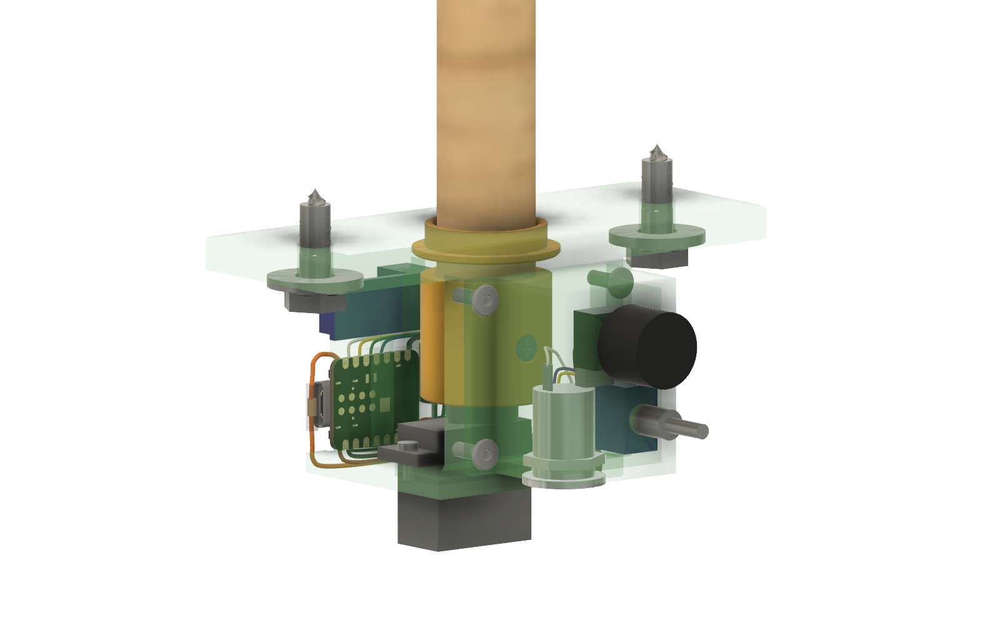

**Control side.** The yellow adapter sits on the servo's output spline, with the bushing directly above it in the flange. The controls sit inside the pod, clear of the spinning adapter.

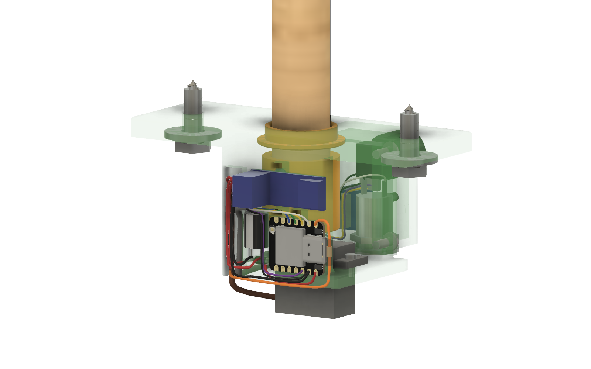

**Electronics side.** The PD board (blue) and XIAO sit in pockets in the wall, held with zip ties. The capacitor snaps into a seat in the wall beside the XIAO; the diode sits in a channel on the inside of that wall, with its leads poking through. Every wire from the [wire list](wiring.md) is modeled, in its own colour.

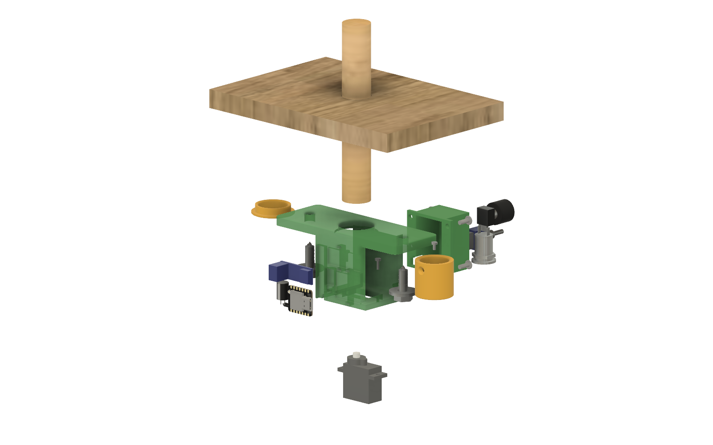

**Exploded view.** The servo comes up from below, the adapter and bushing slide in through the mount's open ends, the boards go onto the side walls, and the pod's controls come out of the pod.

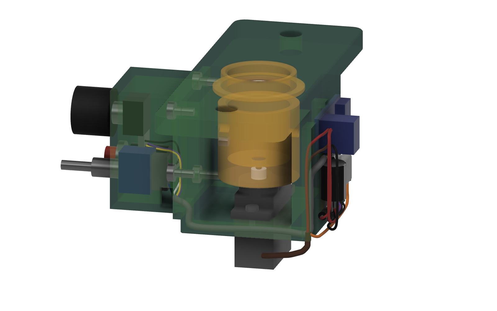

**Wire route.** The control bundle leaves the pod through a notch in its bottom corner, runs down a tunnel hidden behind the pod's back frame, crosses under the base in a channel and climbs the electronics-side groove. The servo cable comes up into the same groove, where its orange signal wire splits off. Nothing crosses the open ends where the adapter turns.

## Wiring, as modeled

The circuit is in the [schematic](images/schematic.svg); the wire-by-wire list and cut lengths are in [wiring.md](wiring.md). This is how it lays out on the mount.

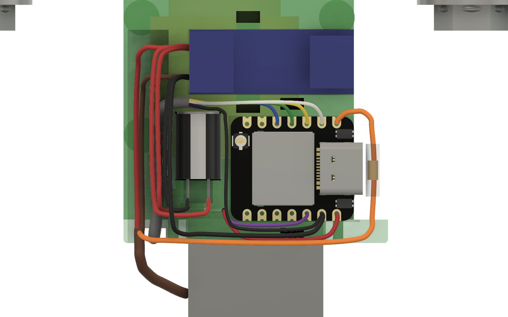

- **C1 and D1:** the capacitor snaps into a round seat beside the XIAO. The diode is on the inside of the same wall, so it's hidden here; its two leads come out through the wall just below the capacitor, where L3 and W3 are soldered on.
- **PD board screw terminal (top left):** + takes the servo red, C1's + lead (L1) and D1's anode (L3). GND takes the servo brown, C1's − lead (L2) and W4.
- **XIAO top row,** from the USB end: D0 orange through R1, then D1 (button lead), D2 yellow, D3 green and D4 blue.
- **XIAO bottom row,** from the USB end: 5V red from D1's banded end (W3), GND with two blacks (W4 from the terminal, W11 to the pod), and 3V3 violet.
- **R1** sits under heat-shrink on the orange wire's run up the right side.

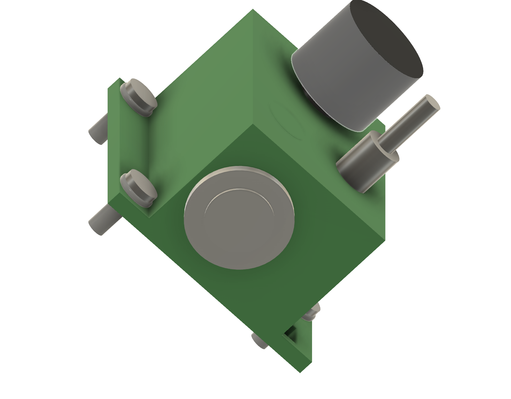

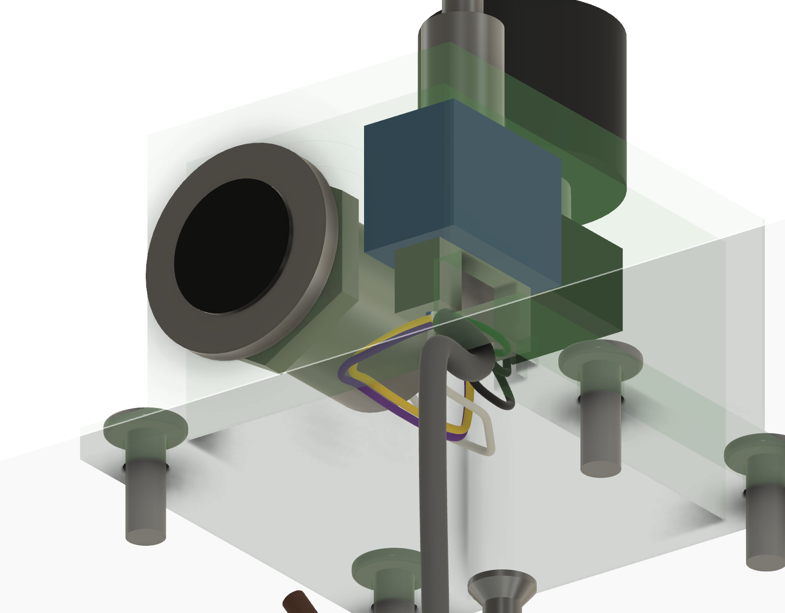

- **Button S1** is in the pod's outer face, the one that looks straight out from the box wall. Its pre-wired lead A runs through the bundle to XIAO D1; lead B goes to the switch's centre lug.
- **Switch SW1:** green to the forward lug, black (W11) to the centre, blue to the reverse lug.
- **Pot RV1:** J2 carries ground from the switch's centre lug to pin 1; yellow and violet climb the back of the pod to the wiper (pin 2) and pin 3.

## What you need

Full list with sources: [parts.md](parts.md) and [hardware/README.md](../../../hardware/README.md).

| Qty | Item | Step |
|---|---|---|
| 1 each | Printed: `Servo_Mount`, `Control_Pod`, and an adapter + bushing for your dowel (3/4", 5/8" or 1/4") | 1–6 |
| 1 | MG90S **360° continuous** servo, with its 2 tab screws and horn screw | 2, 3 |
| 2 | #4 × 3/8" flat-head wood screws (#4 × 1/4" for the 1/4" adapter) | 7 |
| 1 each | XIAO ESP32-C6, USB-C PD trigger board, 1N5817 diode, 470 µF capacitor (8 mm diameter), 330 Ω resistor | 4 |
| — | Hot glue or CA (a dab for the diode) | 4 |
| 2–4 | Small zip ties, 2.5–3.5 mm wide | 4 |
| 1 each | 9 mm B10K pot with knob, MTS-103 ON-OFF-ON toggle, 12 mm stainless momentary button | 5 |
| 4 | M3 × 8 (or × 6) wafer- or pan-head screws | 5 |
| — | Wire: 30 AWG in white, yellow, violet, green, blue, black; 22–26 AWG red and black; heat-shrink. Lengths in the [cut list](wiring.md#cut-list). | 4, 5 |
| 2 + 2 | #14 × 3/4" rounded-head wood screws and 3/4" OD washers | 7 |
| — | Tools: small and long thin Phillips drivers, soldering iron, meter, drill with a bit for the wall hole and a 7/64" (softwood) or 9/64" (hardwood) pilot bit | — |

**Wall hole for the shaft:** 13/16" for a 3/4" dowel, 11/16" for 5/8", 5/16" for 1/4".

## Build it

### 1. Seat the bushing in the flange

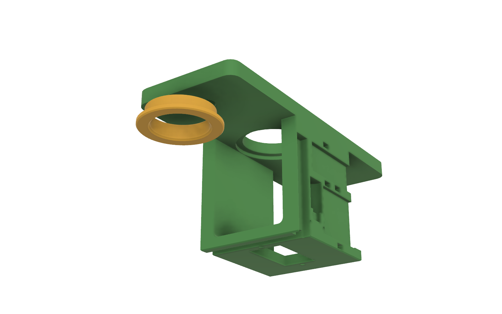

*Parts:* `Servo_Mount`, the bushing that matches your dowel.

1. Hold the mount flange-up. Slide the bushing in through an open end of the mount, with its flange toward the underside of the mount's flange.
2. Push it up into the round recess until its top sits flush with the flange's flat wall face.

> Do this first. Once the servo and adapter are in, there's no room to get the bushing past them. The bushing is a slip fit, so a strip of tape across its face holds it until the shaft goes in.

### 2. Install the servo

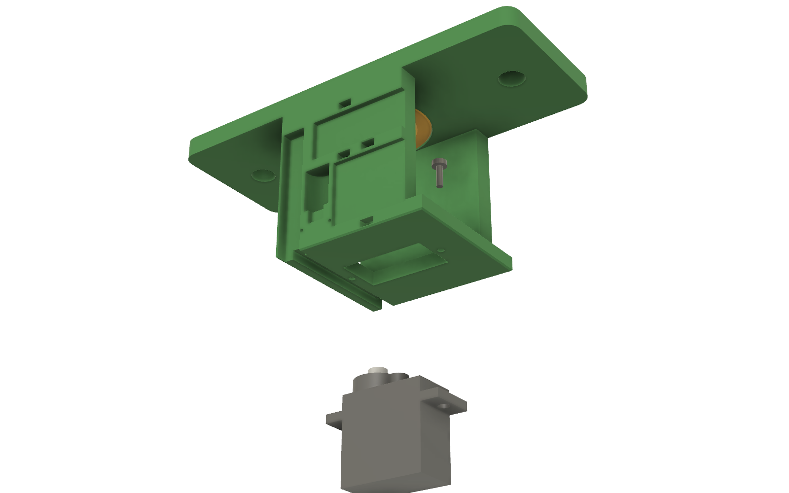

*Parts:* MG90S servo (horn removed), its 2 tab screws.

1. Push the servo up through the cutout in the base, output spline first, until its tabs rest on the base.
2. Turn the servo so its cable exits toward the electronics side, where the cable groove is.
3. Drive the two tab screws into the pilot holes in the base.

### 3. Fit the adapter on the spline

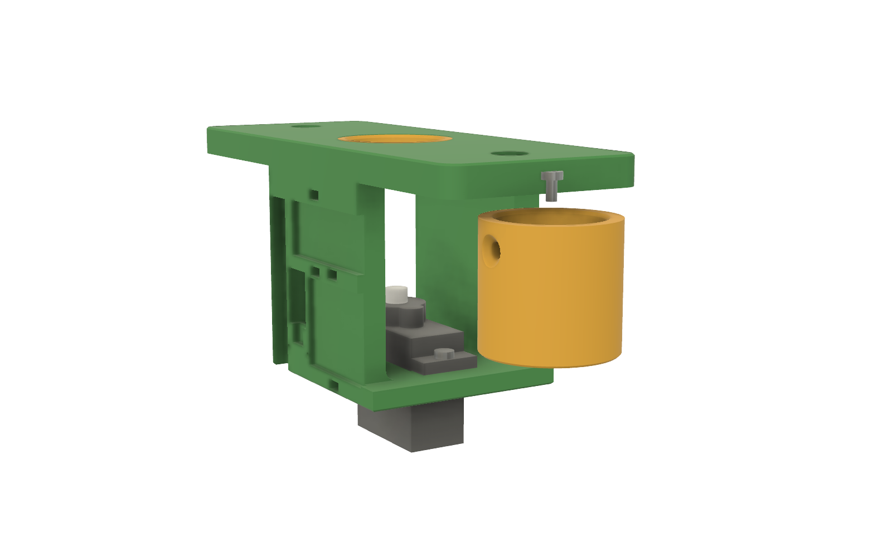

*Parts:* adapter for your dowel, the servo's horn screw.

1. Slide the adapter in through the mount's open end, socket facing up toward the flange.
2. Press it down onto the servo's output spline. The 5.0 mm pocket is sized from the fit-test coupon, so it should be snug.
3. Drive the horn screw down through the hole in the bottom of the socket into the spline. Its head sits at the bottom of the 18 mm socket, so use a long, thin #0 or #1 Phillips.

> The stock MG90S horn screw is about M2 × 4. It needs at least about 4 mm under the head to catch enough of the spline; if yours is shorter, use an M2 × 5 pan head.

### 4. Mount and wire the electronics

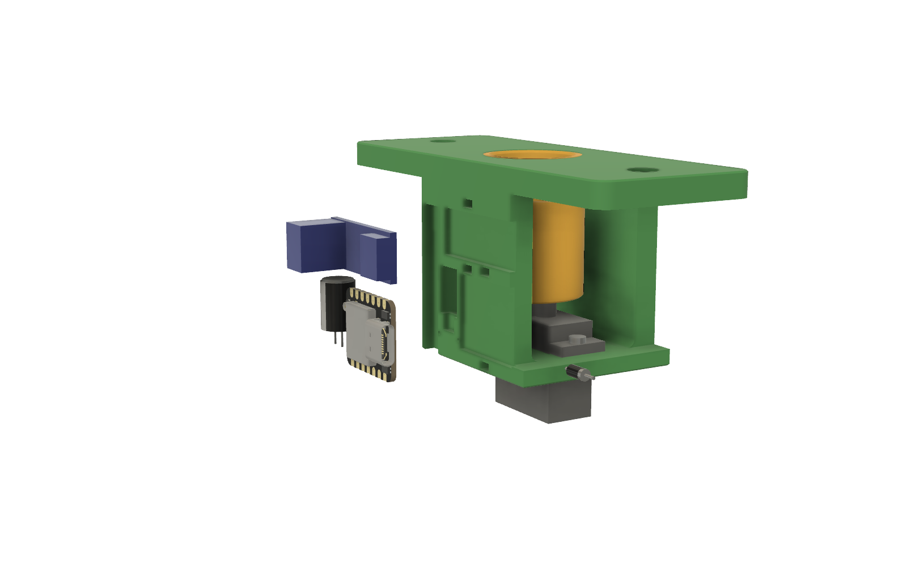

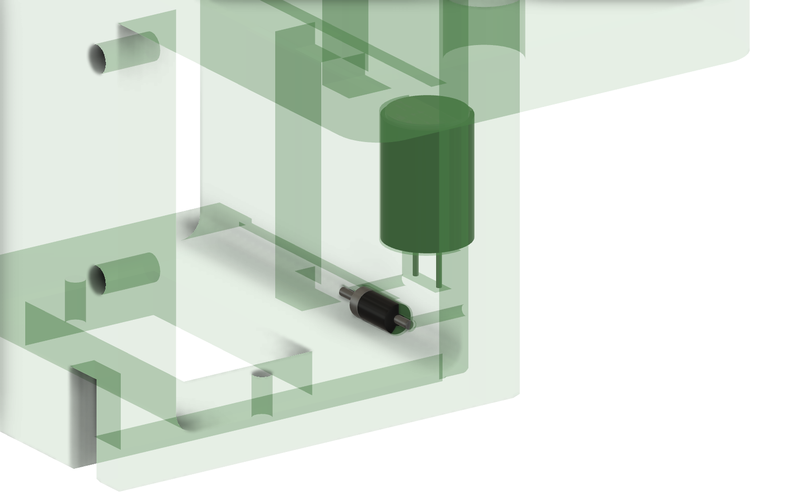

*Parts:* PD board, XIAO ESP32-C6, 1N5817 diode, 470 µF capacitor (8 mm), 330 Ω resistor, zip ties, a dab of glue. Circuit: [schematic](images/schematic.svg).

1. Set the PD board to 5 V. Plug in a charger and confirm 5 V with a meter before connecting anything else.
2. **Diode first, from inside the mount.** Bend the 1N5817's leads 90° right at the body, banded end toward the XIAO's side. Working through the mount's open end, lay the diode in the half-round channel at the bottom of the electronics-side wall's inner face and push both leads out through the two 1 mm holes. A dab of glue in the channel keeps it there. It sits below the adapter and clear of the servo.
3. **Capacitor.** Press the 470 µF capacitor into the round seat on the outside of the same wall, legs down, until it snaps in past the lips. Its legs drop into the slot below the seat. If it won't go in, scrape the lips a little with a knife or raise `c1_seat_dia` by 0.1–0.2 mm and reprint; if it's loose, add a dab of glue.
4. Wire the power and servo connections from the [wire list](wiring.md): capacitor stripe to ground, and solder L3 and W3 to the diode leads where they come through the wall. Put heat-shrink over those two joints.
5. Set the PD board in the upper pocket and the XIAO in the lower pocket, USB-C toward the open end so you can reach it for programming. Thread zip ties through the slots.
6. Run the servo cable along the outer half of the wide groove, from under the base up to the PD board. Leave the inner half free for the control bundle.

### 5. Build and attach the control pod

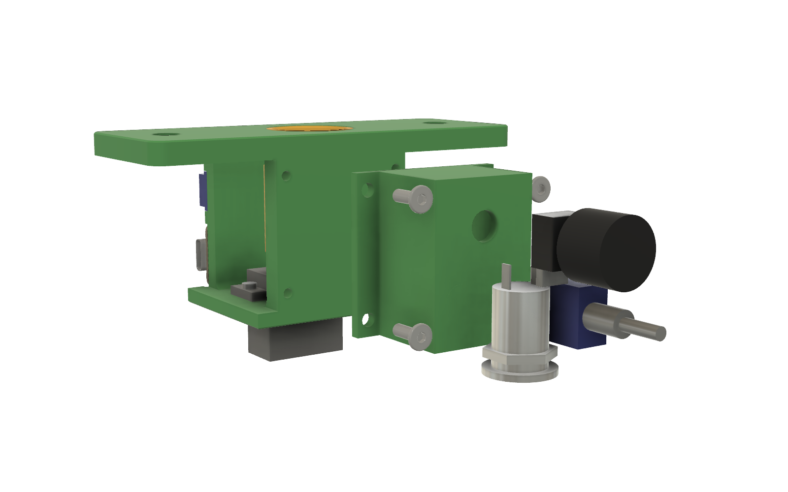

*Parts:* `Control_Pod`, pot and knob, toggle switch, 12 mm button, 4 × M3 screws.

1. Fit the pot and the switch in the pod's side face, each held by its own nut.
2. Fit the 12 mm button from outside into the hole in the pod's outer face. Inside, line the nut's flats up with the pod walls (there's only 0.2 mm to spare) and tighten it by hand while the pod's back is still open.
3. Solder: pot ends to 3V3 (violet) and, through J2, to ground; wiper to D2 (yellow); switch centre to ground (W11), outer lugs to D3 (green) and D4 (blue). Button lead B to the switch's centre lug (J1).
4. Bundle the control wires with the button's lead A and feed them out through the notch at the pod's bottom corner.
5. Press the bundle into the short tunnel in the control-side wall, across the channel under the base and up the inner half of the electronics-side groove to the XIAO.
6. Set the pod against the control-side wall, covering the tunnel, and drive the four M3 screws through the back frame into the pilot holes.

> Route the bundle before screwing the pod on. The pod's back frame closes the tunnel and holds the wires in place.

### 6. Slide the unit onto the shaft

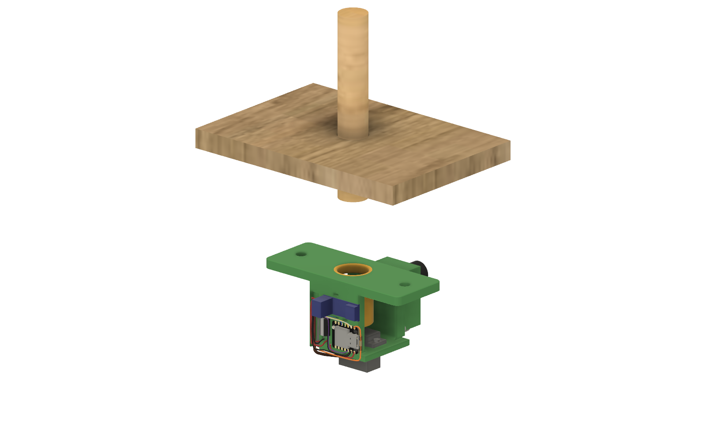

1. The shaft should stick out **28 mm** from the outside of the wall. That puts its end at the bottom of the adapter's socket. Trim it if it's longer.
2. Slide the unit onto the shaft so the shaft passes through the bushing and into the adapter socket.
3. Seat the flange flat against the wall.

### 7. Screw it down and lock the shaft

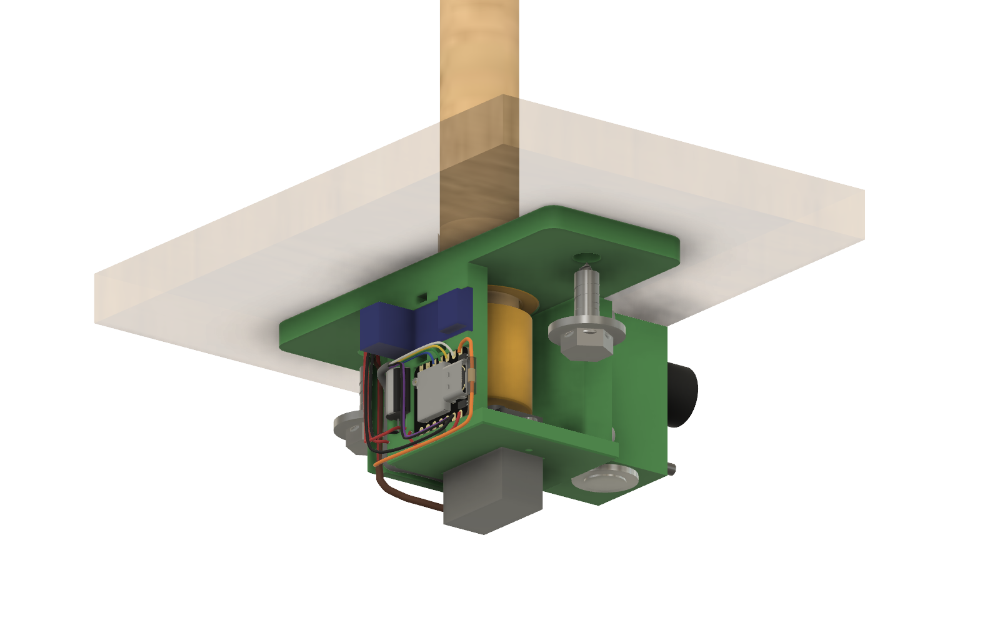

*Parts:* 2 × #14 × 3/4" rounded-head wood screws, 2 × 3/4" washers, 2 × #4 flat-head wood screws.

1. Drill pilot holes through the two ear holes: 7/64" in softwood, 9/64" in hardwood. Drive the #14 screws with washers by hand or on a low clutch setting (they're brass).
2. Turn the adapter by hand until one of its countersunk holes faces the mount's open end. Drive a #4 wood screw through it into the dowel.
3. Turn the adapter half a turn to bring the second hole (on the opposite side, higher up) to the open end, and drive the second screw.

> Power up with the direction switch centred (stop). Set the stop trim first, then try slow speeds before fast ones.

## Sanded or undersize dowels

If a dowel has been sanded below its size, print one of these instead of the plain adapter. They use the same spline base and fit the same mount.

| Dowel | Print | Hardware | Takes up |
|---|---|---|---|
| 5/8" | `Adapter_Clamp_0625` + `Clamp_0625_cap` | 2 × M3 × 10 flat head thread-forming (McMaster 90485A442) | about 1 mm (more with tape) |
| 1/4" | `Adapter_Clamp_025` + `Clamp_025_cap` | 2 × M3 × 10 flat head thread-forming (McMaster 90485A442) | about 1 mm (more with tape) |
| 3/4" | `Adapter_075_Sleeved` + the `Shim_075_for_…` closest to the measured diameter | the two #4 wood screws | 19.0 / 18.5 / 18.0 / 17.5 mm shims |

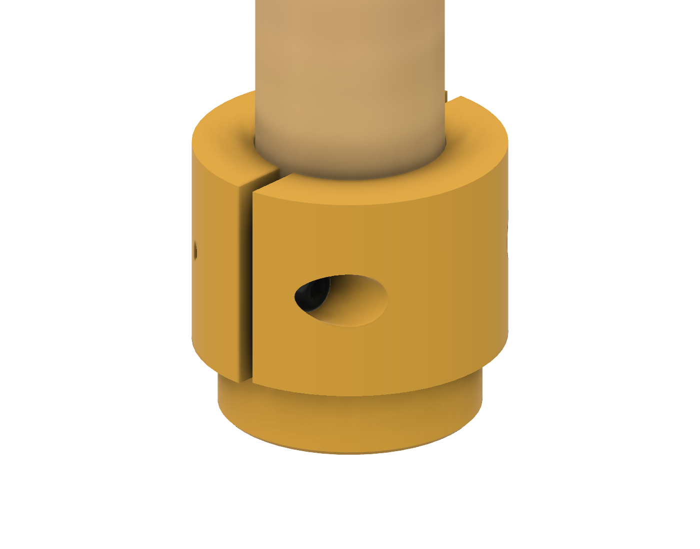

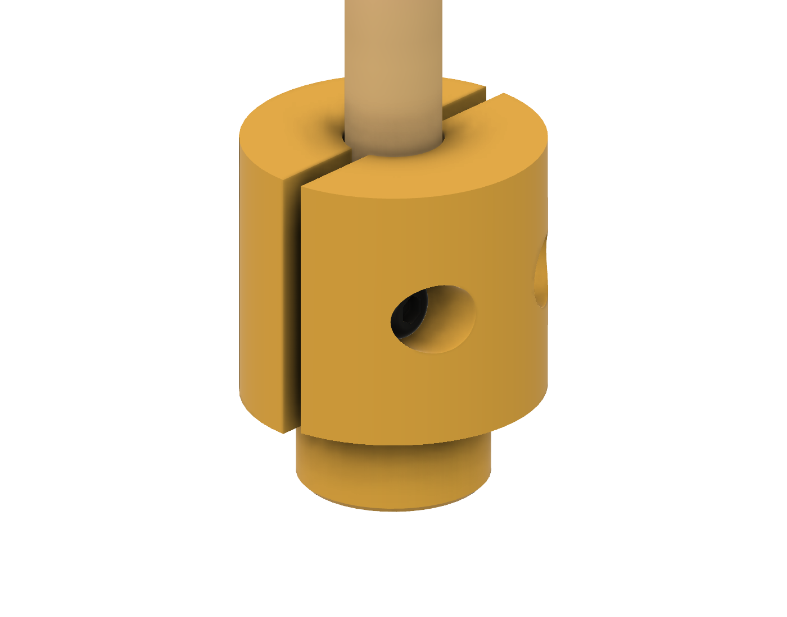

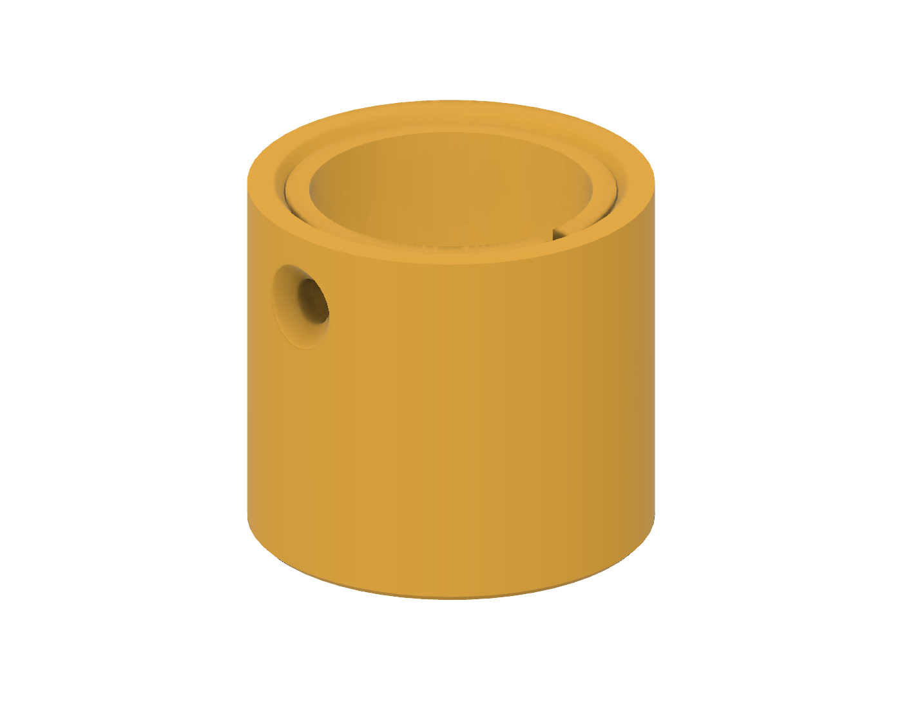

- **Clamps:** fit the cap loosely before sliding onto the shaft. Turn the adapter so each screw faces an open end of the mount, and tighten evenly until the gap stops closing. The M3 thread-forming screws cut their own threads in the 2.5 mm pilots and sit in the cap's countersinks; no inserts are needed. Don't crank them, but do tighten until both heads are below the cap's surface before you turn the shaft: on the 5/8 clamp a head that sticks out more than about 4 mm hits the mount's side wall.
- **Tape:** each wrap of electrical tape adds about 0.36 mm to a dowel's diameter. Only tape a dowel that's already undersize.
- **Shims:** measure the dowel and print the nearest shim, or set `shim_dowel` in Fusion and export a new one. Line its holes up with the adapter's screw holes.

## Notes

- To change dowel size, remove the unit from the wall, swap both the adapter and the bushing, and remount. They're a matched pair.
- The XIAO in the 3D model is an S3 Sense stand-in with the same footprint; the build uses the XIAO ESP32-C6.
