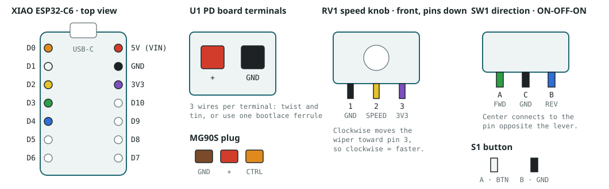

# Wiring

A USB-C PD trigger board set to 5 V powers the MG90S servo directly and feeds the XIAO ESP32-C6 through a diode. The XIAO drives the servo's signal wire from D0. A push button, a speed knob and a forward / stop / reverse switch give hands-on control without a phone. All grounds are tied together.

## Schematic

[Open the schematic full size](images/schematic.svg) (SVG, rev C). It shows the circuit only; where each part sits on the mount is in [assembly step 4](assembly.md#4-mount-and-wire-the-electronics).

## Connections

| From | To | Net |
|---|---|---|
| U1 OUT+ | M1 red, C1 +, D1 anode | +5V |
| D1 cathode | U2 5V pin | +5V |
| U1 OUT− | M1 brown, C1 −, U2 GND | GND |
| U2 D0 (GPIO0) | R1 → M1 orange | SERVO_SIG |
| U2 D1 (GPIO1) | S1 → GND | BTN |
| U2 D2 (GPIO2, A2) | RV1 wiper | SPEED |
| U2 3V3 | RV1 one end (other end to GND) | +3V3 |
| U2 D3 (GPIO21) | SW1 forward throw | DIR_FWD |
| U2 D4 (GPIO22) | SW1 reverse throw | DIR_REV |
| SW1 common | GND | GND |

## Parts

| Ref | Part | Note |
|---|---|---|
| U1 | USB-C PD trigger board | Set to 5 V |
| U2 | Seeed XIAO ESP32-C6 | In the mount's side pocket |
| M1 | MG90S, 360° continuous | Horn removed; adapter on the spline |
| D1 | Schottky diode, 1 A (1N5817 or SS14) | Axial. Lies in a channel inside the mount wall, leads out through two holes; stripe toward the XIAO |
| C1 | Electrolytic, 470 µF, ≥ 10 V, 8 mm diameter | Press-fits into the seat beside the XIAO; mind polarity |
| R1 | Resistor, 330 Ω | In line on the servo signal |
| S1 | 12 mm stainless momentary push button, 1 NO, pre-wired 150 mm leads | In the pod's outer face |
| RV1 | 9 mm potentiometer, 10 kΩ linear (B10K), M7 bushing, with knob | Pod side face |
| SW1 | MTS-103 mini toggle, ON-OFF-ON, 1/4" bushing | Pod side face; centre = stop |

## Point-to-point wire list

Follow this table one wire at a time and tick each off. The colours match the 3D model; what matters is that each end lands on the terminal listed. The XIAO's power pin is printed 5V; it's the board's VIN.

| Wire | Colour | From | To | Notes |
|---|---|---|---|---|
| **Power harness, 22–26 AWG** | | | | |
| W1 | red | Servo red (+) | U1 + terminal | Cut off the servo plug and strip. |
| W2 | brown | Servo brown (GND) | U1 GND terminal | |
| L1 | red | C1 + (long leg) | U1 + terminal | Lead extends the capacitor leg. |
| L2 | black | C1 − (stripe side) | U1 GND terminal | Reversed polarity damages the capacitor. |
| L3 | red | D1 anode (plain end) | U1 + terminal | Solder to the lead where it comes through the wall; heat-shrink the joint. |
| W3 | red | D1 cathode (banded end) | XIAO 5V (VIN) | Solder to the lead where it comes through the wall; heat-shrink the joint. |
| W4 | black | U1 GND terminal | XIAO GND | |
| **Servo signal** | | | | |
| W5 | orange | Servo orange (signal) | R1 → XIAO D0 | R1's own lead covers the last 15 mm; heat-shrink over it. |
| **Control bundle, 30 AWG, through the pod notch → tunnel → base channel → groove** | | | | |
| W6 | button lead | S1 lead A | XIAO D1 | The button's own pre-wired lead runs all the way (about 141 mm of its 150 mm). |
| W7 | yellow | XIAO D2 | RV1 pin 2 (wiper) | |
| W8 | violet | XIAO 3V3 | RV1 pin 3 | 3.3 V only, never 5 V. |
| W9 | green | XIAO D3 | SW1 outer lug A (forward) | |
| W10 | blue | XIAO D4 | SW1 outer lug B (reverse) | |
| W11 | black | XIAO GND | SW1 centre lug | Ground for the whole pod starts here. |
| **Pod ground** | | | | |
| J1 | button lead | S1 lead B | SW1 centre lug | The button's other pre-wired lead, trimmed. Button leads are interchangeable. |
| J2 | black | SW1 centre lug | RV1 pin 1 | Carries ground on to the knob. |

### Terminal check

When you're done, every terminal should hold exactly this many wires.

| Terminal | Wires landing here | Count |
|---|---|---|
| U1 + terminal | W1 servo red · L1 C1 + · L3 D1 anode | 3 |
| U1 GND terminal | W2 servo brown · L2 C1 − · W4 to XIAO | 3 |
| XIAO 5V (VIN) | W3 from D1 cathode | 1 |
| XIAO GND | W4 from U1 · W11 to pod | 2 |
| XIAO 3V3 | W8 to RV1 pin 3 | 1 |
| XIAO D0 | W5 servo signal (through R1) | 1 |
| XIAO D1 / D2 / D3 / D4 | W6 / W7 / W9 / W10 | 1 each |
| RV1 pins 1 / 2 / 3 | J2 GND / W7 SPEED / W8 3V3 | 1 each |
| S1 leads A / B | W6 BTN / J1 GND | pre-wired |
| SW1 A / centre / B | W9 FWD / W11 + J1 + J2 GND / W10 REV | 1 / 3 / 1 |

## Cut list

Lengths measured along the routes in the 3D model, plus 15% slack for routing and twisting and 5 mm per end for stripping, rounded up to 5 mm. Also in [`cut-list.csv`](cut-list.csv).

| Wire | Colour | Gauge | Routed | **Cut** |
|---|---|---|---|---|
| W1 | red | servo cable | 65 mm from the servo case | **trim to 85** |
| W2 | brown | servo cable | 59 mm | **trim to 80** |
| W5 | orange | servo cable | 74 mm to R1 | **trim to 95** |
| L1 | red | 22–26 AWG | 49 mm | **70** |
| L2 | black | 22–26 AWG | 35 mm | **50** |
| L3 | red | 22–26 AWG | 36 mm | **55** |
| W3 | red | 22–26 AWG | 25 mm | **40** |
| W4 | black | 22–26 AWG | 59 mm | **80** |
| W6 | button lead | pre-wired | 141 mm | **use the 150 mm lead** |
| W7 | yellow | 30 AWG | 137 mm | **170** |
| W8 | violet | 30 AWG | 157 mm | **195** |
| W9 | green | 30 AWG | 111 mm | **140** |
| W10 | blue | 30 AWG | 101 mm | **130** |
| W11 | black | 30 AWG | 130 mm | **160** |
| J1 | button lead | pre-wired | 21 mm | **trim to 35** |
| J2 | black | 30 AWG | 17 mm | **30** |

## Why it's wired this way

- The servo takes its power straight from the PD board, not from the XIAO, so servo current spikes don't pass through the XIAO.
- Seeed's guidance for powering a XIAO from an outside source on its 5V pin is to put a diode in line. D1 does that, and stops the PD board and the XIAO's own USB port from back-feeding each other, so you can plug in a laptop to reprogram while the PD board is connected.
- C1 smooths the dips when the servo starts or reverses, which keeps the XIAO from browning out and resetting.
- One common ground is required. Without it the servo can't read the signal.
- The button and switch need no resistors. D1, D3 and D4 use the chip's internal pull-ups, so each reads LOW only when its contact closes to ground. With the switch centred, both D3 and D4 read HIGH, which the firmware treats as stop.
- The speed knob runs from 3V3, not 5 V, because the XIAO's analog input can't take more than 3.3 V.
- When the switch changes direction, the firmware ramps the servo down through stop before reversing. That spares the gears and whatever is riding on the cams.
- D4 is also the default I²C data pin (SDA). That's fine while nothing uses I²C.
- D0 is GPIO0 on the ESP32-C6. It isn't a boot-strapping pin, so it's a safe choice for the servo signal.

## Bring-up

1. Set the PD board to 5 V. Plug in the charger and measure OUT+ to OUT− with a meter before wiring anything.
2. Before applying power, use the meter's continuity mode to check each row of the terminal check table, and confirm that + and GND are not connected to each other.
3. Wire ground first, then +5V, then the signal. Check C1's polarity (stripe = −) and D1's orientation (stripe toward the XIAO). D1 goes into the mount before you solder its leads; see [assembly step 4](assembly.md#4-mount-and-wire-the-electronics).
4. Flash the firmware (see [`firmware/README.md`](../../../firmware/README.md)). On first power-up, open Settings → Stop trim and adjust until the shaft stands still.
5. Check the controls: the button should start and pause a story, the knob should change speed, and the switch should run forward, stop in the centre, and reverse.

Pin mapping and the 5V-pin diode guidance are from Seeed's XIAO ESP32-C6 wiki. Check your PD board's markings for its exact voltage setting.
