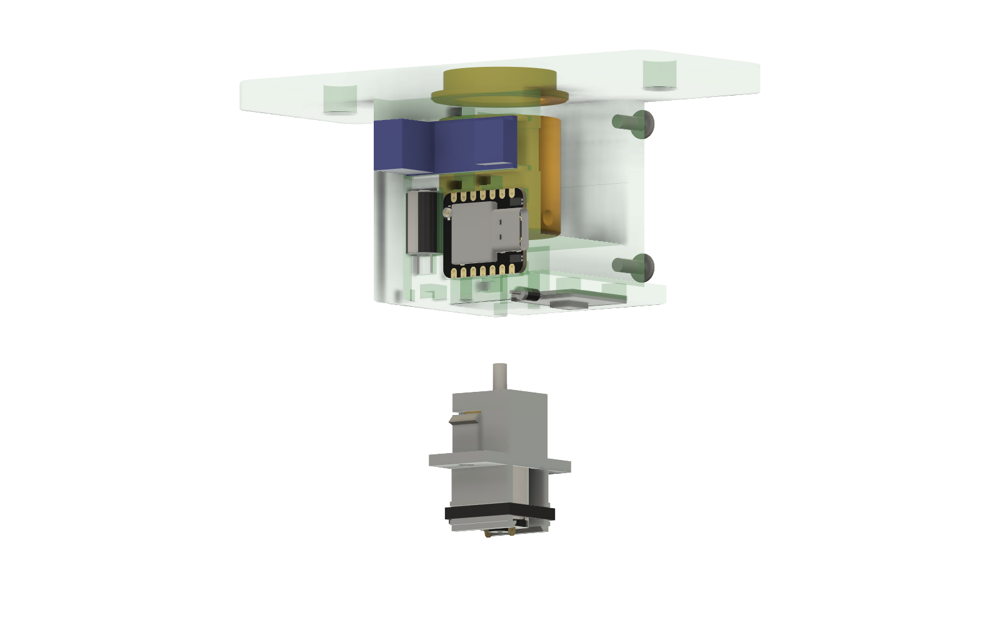
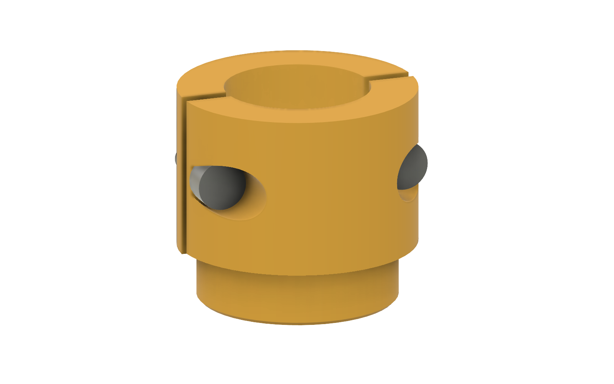

# N20 drive

A version of the drive built around a 6 V N20 metal gearmotor and a DRV8833 motor driver, in place of the MG90S servo. The N20 is smaller, quieter and turns more smoothly at low speed than a modified servo, and you choose its speed and torque by picking a gear ratio.

**Status: ready for a PETG fit test (2026-10-26).** The first printed mount showed the motor's screw holes are the inline pair and that the boards need room for solder underneath (fixed 2026-10-24). A change request then reworked the capacitor and diode, the wiring, the clamps, the motor mount and the control panel connector; see [What changed on 2026-10-26](#what-changed-on-2026-10-26). Print the PETG fit coupon, the cartridge and the mount fit coupon (pieces of the real mount and pod that check the capacitor, diode, board, cartridge, zip-tie and connector fits) before the mount (see [cad/stl](cad/stl/README.md)). Wiring, schematic and cut list are in [docs/wiring.md](docs/wiring.md); the build order is in [Assembly order and tool access](#assembly-order-and-tool-access).

- **Fusion design:** *Cam Rotation N20* in MovementStudy › Cam Rotation Tool, copied from *Cam Rotation Starter*. The N20 reference model is *N20 DC MOTOR*, copied into the same folder.

## What carries over from the MG90S drive

| Part | Reused as is? | Notes |
|---|---|---|
| XIAO ESP32-C6, USB-C PD trigger board (5 V), 1N5817 diode | Yes | Same power path: PD 5 V feeds the motor side; the XIAO gets 5 V through the diode, which now lies under the base. |
| 470 µF capacitor | Yes, 8 × 13 mm | The seat is 14 mm tall for the 13 mm can. |
| 12 mm button, speed knob, direction switch | Yes | Same pins as the MG90S drive (D1, D2, D3, D4), now through a 6-pin JST-PH connector (J3). |
| Control pod | Changed | `N20_Control_Pod` has a holder for the J3 header inside; print it from this drive's folder. |
| Bushings, dowel gauges, shims | Yes | Print them from [`drives/mg90s/cad/stl`](../mg90s/cad/stl/README.md). |
| Dowel adapters, clamp bodies and caps | No | Same dowel sockets and grip screws, but a 3 mm D-shaft bore through the base in place of the servo spline pocket and horn screw. The clamps take M3 socket cap screws in flat-bottomed counterbores. `N20_Adapter_*` and `N20_Clamp_*` in [cad/stl](cad/stl/README.md). |
| Mount | Changed | `N20_Mount`: same walls, flange, pod face and XIAO pocket; the PD board sits on a 3.5 mm pad on the outside of the wall. The motor sits in a printed cartridge (`N20_Cartridge`) that slides up through a socket in the base and screws on from below, on the dowel axis. The DRV8833 sits in a pocket on the underside of the base, with the diode in a channel beside it. Both boards' pockets have a 2.5 mm relief under their pin rows for wire ends and solder. |
| 330 Ω signal resistor (R1) | Dropped | Not needed for a motor driver input. |
| Firmware | Shared | Same story player and web app; a DRV8833 motor output in place of the servo pulse (see below). |

## New parts

| Ref | Qty | Part | Notes |
|---|---|---|---|
| M1 | 1 | N20 gearmotor, **6 V, 100:1**, no encoder | Chosen for speed (see Decisions). Other ratios fit the same cartridge. Typical 6 V no-load speeds are about 300 rpm at 100:1, 100 rpm at 298:1 and 30 rpm at 1000:1; at 5 V expect about 80% of that. 298:1 is closest to the MG90S's top speed (about 100 rpm) with more torque. |
| U3 | 1 | DRV8833 dual motor driver module, 12-pin (two rows of six 0.1" pins: IN4 IN3 GND VCC IN2 IN1 / EEP OUT1–OUT4 ULT), sold in 5-packs (e.g. "EC Buying") | Channel B (IN3/IN4 → OUT3/OUT4) is used. Motor supply 2.7–10.8 V, about 1.5 A per channel. Leave the J1 jumper open. |
| J3 | 1 | JST-PH 2.0 mm 6-pin: B6B-PH-K-S header, PHR-6 housing, 6 crimp contacts (or a pre-crimped PH pigtail) | Makes the control panel detachable. |
| — | 2 | **M1.6 × 4** pan-head screws + **M1.6 split lock washers** | Motor into the cartridge. The grip under the head is 2 mm (1.5 mm plate + 0.5 mm washer), so 4 mm leaves 2 mm in the gearbox face; don't go longer, the holes are shallow. |
| — | 2 | **M3 × 8** socket cap screws (ISO 4762), thread-forming or plain | Cartridge to the mount, from below. |
| — | 2 per clamp | **M3 × 8** socket cap screws | Clamp caps. M3 × 10 is too long for the 5/8 clamp: its tip would come out of the side. |
| — | 1 | Double-sided foam tape, about 15 × 15 mm | Holds the DRV8833 module in its pocket. |
| — | 1 | 0.1 µF ceramic capacitor | Solder across the N20's terminals to cut electrical noise. |
| — | 3–4 | Small zip ties, 2.5 mm wide | Through the tie anchors under the wall (power wires) and under the base (motor wires). |
| — | — | Hot glue or CA | A dab to hold D1 in its channel and the J3 header in its holder. |

## Wiring plan

| From | To | Why |
|---|---|---|
| PD board + (5 V) | C1 +, DRV8833 VCC | Motor supply (VCC on this module is the DRV8833's VM); the capacitor buffers start-up current |
| PD board GND | C1 −, DRV8833 GND | Common ground |
| DRV8833 VCC | D1 anode → D1 cathode → XIAO 5V | The diode's own leads; same job as on the MG90S drive |
| DRV8833 GND | XIAO GND | Common ground |
| XIAO D10 (GPIO18) | DRV8833 IN3 | PWM forward |
| XIAO D9 (GPIO20) | DRV8833 IN4 | PWM reverse |
| XIAO D8 (GPIO19) | DRV8833 EEP (nSLEEP) | Keeps the driver asleep until the firmware is running, so the motor can't twitch at power-up. Leave the module's J1 jumper open: bridging it ties EEP high. |
| DRV8833 OUT3, OUT4 | N20 terminals | Swap them if forward runs backwards |
| XIAO D1–D4, 3V3, GND | J3 → button, knob, switch | Six wires through the 6-pin JST-PH, so the panel unplugs |

IN1, IN2, OUT1, OUT2 and ULT (the fault output) stay unconnected. D0 and D5 are free.

The full wire list, J3 pinout, schematic and cut list are in [docs/wiring.md](docs/wiring.md).

## Firmware

Both drives build from the one `firmware/` folder; the motor output is chosen at build time. Build the N20 version with the `sdkconfig.n20` fragment (see [Drive type](../../firmware/README.md#drive-type)):

- `motor_drv8833.c` has the same speed interface as the servo's `servo.c`: two LEDC PWM channels at 20 kHz (above hearing) in slow-decay mode, so the motor brakes between pulses and stops dead at zero
- nSLEEP stays low until the firmware runs, and goes low again after the motor has been stopped for `idle_release_ms`
- the web app hides the stop trim and the µs range on an N20 box

To check on hardware: the lowest speed at which your N20 still turns under the cam's load. If it stalls and hums at low knob settings, the firmware needs a minimum duty setting.

## Decisions

- **Gear ratio: 100:1.** About 300 rpm at 6 V, so about 240 rpm at the 5 V the PD board supplies: faster than the MG90S (about 100 rpm), with less torque. Story speeds will feel about twice as fast at the same percentage; lower the speeds in a story, or the knob, to match.
- **Layout: direct drive.** The N20 sits on the dowel axis, like the servo spline, and turns the dowel through an adapter with a 3 mm D-shaft bore (3.0 mm round, 2.5 mm across the flat, `n20_bore_clear` per side).
- **Driver: the 12-pin DRV8833 module** described above: 18.5 × 16 mm, its two pin rows 0.6" (15.24 mm) apart along the 18.5 mm side.
- **Gearbox screw holes: the inline pair,** 9 mm apart across the 12 mm width, at (±4.5, 0). The first mount followed the N20 reference model's diagonal pair (9.4 mm apart), which didn't match our motors. The reference model in Fusion still shows the diagonal holes.
- **Room to solder under the boards.** Wires soldered through the XIAO's and the DRV8833's pin rows leave ends and solder on the back of the board, so each pocket has a 2.5 mm relief under both pin rows (`solder_relief_d`). The boards rest on the strip between the rows.
- **Room under the PD board: a 3.5 mm pad.** The USB-C PD board has parts all over its underside, and the wall behind its pocket was already used up by the zip-tie tunnel and the clamp-head relief on the inside. So the board moved 3.5 mm out (`pd_relief_d`) onto a pad on the outside of the wall: it rests on a 1 mm ledge round its edges, with 3.5 mm clear under the rest. The zip-tie tunnel and slots didn't move; the tie runs out of its slots just above and below the pad and over the board. The mount is 3.5 mm wider on that side (44.8 mm), and the PD board's wires (W1, W2, W4, L1–L3) end 3.5 mm further out; W2 and L2 are cut 5 mm longer.

## What changed on 2026-10-26

From the change request after the first build attempt:

| # | Change | What it is now |
|---|---|---|
| 1 | Capacitor seat | Press fit for the 8 × 13 mm can: 8.0 mm across, 4.9 mm deep so its 7.8 mm mouth holds the can, and 14 mm tall (13 mm + 1 mm for the leads). It sits 1.6 mm lower than before so the control wires clear its top. |
| 2 | Diode | Out of the wall: in a channel under the base, in line with the XIAO's 5V pad and the DRV8833's VCC pin, reachable from below with fingers and an iron. Its own leads make both joints, so W3 and L3 are gone. |
| 3 | Layout and wiring | The driver signals moved to the XIAO's bottom row (D10, D9, D8) and the module's channel B, right under them, so W4, W5 and W12 are about 20 mm long instead of 45–66 mm. Power runs in two lanes under the electronics-side wall. Firmware pins changed to match (`firmware/main/board.h`). |
| 4 | Dowel clamps | Flat-bottomed 6.0 mm counterbores for M3 socket cap heads, 2.0 mm above the split. The 5/8 clamp's screws moved out to 10.6 mm (1/4 clamp: 5.9 mm) to thicken the wall beside the bore; pilots are 6.5 mm deep for M3 × 8. The 5/8 clamp with its screws sweeps 14.3 mm at most, inside the 15.3 mm wall relief, and clears the case all the way round. |
| 5 | N20 mount | A removable cartridge: the motor screws to its 3 mm top plate with M1.6 × 4 screws and lock washers in 3.8 mm counterbores (heads flush), at the measured 9 mm inline spacing; the cartridge slides up into a socket in the base and two M3 × 8 screws hold it from below. |
| 6 | Shaft coupling | D-bore unchanged in the adapters (`n20_bore_clear` 0.15 mm); the PETG coupon tests 0.10–0.30 mm. |
| 7 | Assembly access | Every fastener can be reached in the build order below. The cartridge removed the only blocked one (the motor screws used to sit under the adapter), so no extra access holes were needed. |
| 8 | Control panel | The pod's button, knob and switch holes were already in place. A holder for a 6-pin JST-PH header (J3) is now inside the pod, so the panel unplugs. |
| 9 | Strain relief, USB-C | Two zip-tie anchors: A1 under the electronics-side wall for the power wires, A2 under the base for the motor wires. The XIAO's USB-C port has a clear path for a plug with everything assembled. |
| 10 | PETG | `N20_PETG_Fit_Coupon`: 5/8" holes at +0.2 to +0.6 mm, M3 clearance, pilot and cap-head counterbore sizes, M1.6 clearance and counterbore sizes in a 3 mm plate, and five D-bores. |






## Assembly order and tool access

Checked in the model with a 2.5 mm hex key, a small screwdriver and room for a hand at each step.

1. **Bench: motor into the cartridge.** Push the N20's gearbox up into `N20_Cartridge` until its face meets the top plate, shaft through the middle hole. Put a split lock washer on each M1.6 × 4 screw and drive them into the gearbox face through the counterbores. The heads end up flush with the plate.
2. **Bench: wiring.** Wire the boards, D1 and C1 as in [docs/wiring.md](docs/wiring.md), solder W14, W15 and C2 to the motor, and crimp the J3 housing onto the harness.
3. **Bushing in** through the mount's open end, flange up into the flange recess (as on the MG90S drive).
4. **Mount on the box wall** with the #14 screws through the flange ears.
5. **Dowel through** the bushing.
6. **Adapter or clamp on the dowel, then tighten.** Turn the clamp so its cap faces an open end of the mount; both cap screws then point out of that end, and a 2.5 mm hex key goes straight in.
7. **Press the cartridge onto the shaft.** From below, push the cartridge up through the socket in the base so the D-shaft enters the adapter's bore; turn the dowel to line up the flat.
8. **Tighten the cartridge** with two M3 × 8 cap screws up through the flange into the base. The motor hangs between them, with room for the key and your hand.
9. **Control panel.** Plug J3 into the header in the pod, then screw the pod on (four M3 screws, as before). Reverse this to take it off.

## Fusion design

*Cam Rotation N20* (version 10 or later) holds the N20 changes on top of the MG90S design. The servo and its screws are hidden, not deleted. User parameters added for this drive:

| Parameter | Default | What it controls |
|---|---|---|
| `n20_face_z` | 0 mm | Height of the gearbox face (the adapter bottom stays at 4.2 mm) |
| `n20_clear` | 0.3 mm | Clearance around the gearbox in its sleeve |
| `n20_plate_thk`, `n20_tube_wall` | 2 mm | The mount's face plate (the cartridge socket now goes through it) and its old sleeve wall |
| `cart_plate`, `cart_wall`, `cart_flange` | 3, 1.2, 2.4 mm | Cartridge top plate, wall around the gearbox, and bottom flange |
| `cart_clear` | 0.3 mm | Cartridge in the mount socket (the socket is `n20_w`/`n20_d` + 2 × (`n20_clear` + `cart_wall` + `cart_clear`)) |
| `cart_ear_y`, `cart_flange_w` | 11.5, 29 mm | Cartridge M3 screws, and the flange length that carries them |
| `cart_m3_clear`, `cart_m3_pilot`, `cart_m3_depth` | 3.4, 2.5, 7.5 mm | Cartridge screw holes; the pilots go right through the 6.9 mm floor |
| `floor_top` | −3.5 mm | Top of the solid floor the cartridge screws into |
| `m16_clear`, `m16_cbore`, `m16_cbore_d` | 1.9, 3.8, 1.5 mm | M1.6 holes in the cartridge plate, and counterbores for the heads on lock washers |
| `n20_hole_x`, `n20_hole_y` | 4.5, 0 mm | Face screw holes, at (+x, +y) and (−x, −y): 4.5, 0 is the inline pair; 3.8, 2.8 the diagonal pair |
| `n20_shaft_hole` | 4.5 mm | Shaft hole in the cartridge plate |
| `n20_shaft_dia`, `n20_flat` | 3.0, 2.5 mm | The motor shaft and its D flat |
| `n20_bore_clear` | 0.15 mm | D-bore clearance; set it from the fit coupon |
| `drv_len`, `drv_wid`, `drv_thk` | 18.5, 16, 1.6 mm | The DRV8833 module |
| `drv_x`, `drv_pocket_d` | 18.15, 1 mm | Its pocket on the underside of the base |
| `pd_relief_d` | 3.5 mm | Room under the PD board: the thickness of the pad it sits on, outside the electronics-side wall |
| `solder_relief_d` | 2.5 mm | Relief under the XIAO's and the DRV8833's pin rows, below the pocket floor. Under the DRV8833 it leaves 0.5 mm of base; 2.0 mm leaves 1 mm. |
| `wall_relief_d`, `wall_relief_z0`, `wall_relief_h` | 0.6, 15, 9 mm | Relief in the inside of both side walls where the 5/8 clamp's screw heads pass. 0.6 mm leaves 1 mm of wall in front of the PD board's zip-tie tunnel. |
| `clamp_cb_y`, `clamp_cbore` | 2.0, 6.0 mm | Flat counterbore floor for the M3 cap heads, above the clamp split, and its diameter |
| `clamp_x_mid`, `clamp_x_small` | 10.6, 5.9 mm | Clamp screw offsets (5/8, 1/4) |
| `clamp_pilot_depth` | 6.5 mm | M3 pilots in the clamp bodies |
| `c1_seat_dia`, `c1_seat_depth`, `c1_seat_h`, `c1_seat_z0` | 8.0, 4.9, 14, −1.3 mm | Capacitor seat |
| `d1_x`, `d1_axis_z`, `d1_y0`, `d1_len`, `d1_seat_dia`, `d1_lead_slot` | 19.42, −10.6, −19, 6.4, 2.9, 1.1 mm | Diode channel and lead slot under the base |

`d1_x`, `d1_axis_z` and `cart_ear_y` record where the diode channel and the cartridge screws are; their sketches use those numbers but aren't linked to the parameters, so move those sketches as well if you change them. The cartridge's M1.6 holes do follow `n20_hole_x`/`n20_hole_y`.

## Folder layout

```
cad/step/   cam-rotation-n20.step and .f3d: snapshots of the Fusion design
cad/stl/    print files for the parts that differ from the MG90S drive
cad/fusion/ orient_stl.py for this drive's STLs; wires.py rebuilds the Wiring component; shots.py renders docs/images
docs/       wiring.md, cut-list.csv, images/ (schematic, renders)
```
