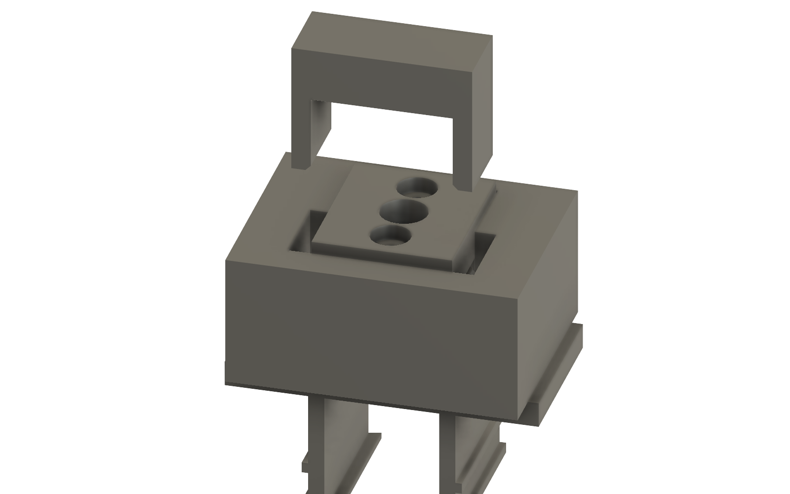
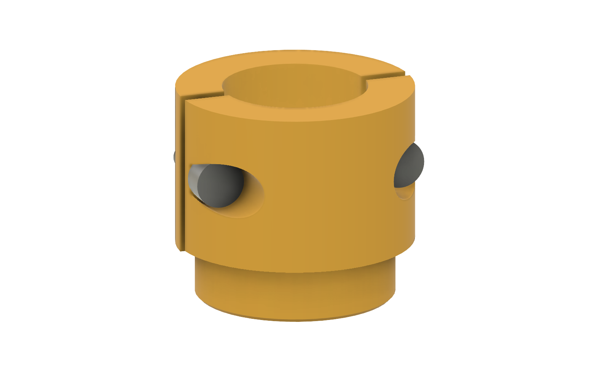

# N20 drive

A version of the drive built around a 6 V N20 metal gearmotor and a DRV8833 motor driver, in place of the MG90S servo. The N20 is smaller, quieter and turns more smoothly at low speed than a modified servo, and you choose its speed and torque by picking a gear ratio.

**Status: rev C designed (2026-10-31), not yet built; rev B was ready for a PETG fit test (2026-10-26).** The first printed mount showed the motor's screw holes are the inline pair and that the boards need room for solder underneath (fixed 2026-10-24). A change request then reworked the capacitor and diode, the wiring, the clamps, the motor mount and the control panel connector; see [What changed on 2026-10-26](#what-changed-on-2026-10-26). Since 2026-10-27 the motor and its cartridge snap in, with no screws (see [Snap-fit motor](#snap-fit-motor-2026-10-27)). Print the PETG fit coupon, the cartridge with the socket coupon, and the mount fit coupon (pieces of the real mount and pod that check the capacitor, diode, board, cartridge, zip-tie and connector fits) before the mount (see [cad/stl](cad/stl/README.md)). Wiring, schematic and cut list are in [docs/wiring.md](docs/wiring.md); the build order is in [Assembly order and tool access](#assembly-order-and-tool-access).

**Rev C (2026-10-31): perfboard electronics, ESP32-C6 Super Mini, motor strain relief.** The electronics are soldered onto an ElectroCookie perfboard on the mount's electronics-side (−Y) face, under a printed cover that forms the mount's outer wall. That covers the USB-C PD board, the ESP32-C6 Super Mini, the DRV8833, the diode, a board-mounted speed knob and a plug for the motor. Both USB-C ports face −X. The motor's wires are tied to the cartridge right beside its terminals. See [What changed on 2026-10-31](#what-changed-on-2026-10-31-rev-c), the hole map in [docs/perfboard.md](docs/perfboard.md), and the wiring in [docs/wiring.md](docs/wiring.md). Not yet printed or built.

- **Fusion design:** *Cam Rotation N20* in MovementStudy › Cam Rotation Tool, copied from *Cam Rotation Starter*. The N20 reference model is *N20 DC MOTOR*, copied into the same folder.

## What carries over from the MG90S drive

| Part | Reused as is? | Notes |
|---|---|---|
| USB-C PD trigger board (5 V), 1N5817 diode | Yes | Same power path: PD 5 V feeds the motor side; the board gets 5 V through the diode. From rev C both are on the perfboard, and the PD board's screw terminal is removed. |
| XIAO ESP32-C6 | Replaced in rev C | By an ESP32-C6 Super Mini on the perfboard. The mount keeps the XIAO pocket, so a rev B build with a XIAO still fits; the firmware builds for either board. |
| 470 µF capacitor | Yes, 8 × 13 mm | From Fusion version 29 it stands on the perfboard, its top through a 9 mm hole in the cover; the mount's seat for it is gone. |
| 12 mm button | Yes | In its mount in the pod, wired straight to the perfboard (GPIO1 and GND on the Super Mini). The direction switch was dropped: it never arrived, and the drive runs forward. |
| Speed knob | Changed in rev C | An RK097N 10 kΩ pot on the perfboard, its shaft through the electronics cover. Its wiper and low end go straight into the GPIO4 and GPIO3 strips, and the firmware drives GPIO3 low as its ground. The pod's knob hole is unused. |
| Control pod | Changed | `N20_Control_Pod`; print it from this drive's folder. From Fusion version 30 its J3 header holder is gone; the switch hole in its front panel is left empty. |
| Bushings | Yes, from 2026-11-03 | Ø29.0 mm with a double-D flange, for the Ø29.2 mm bore that passes the assembled 5/8 clamp. The flange sits in a recess in the mount's wall face, so the bushing goes in from the wall side and the box wall holds it. Both drives now use this design (a shared part again): `N20_Bushing_*` here and `Bushing_*` in the MG90S folder are the same. Older MG90S bushings (Ø23.55 mm) don't fit either mount any more. |
| Dowel gauges, shims | Yes | Print them from [`drives/mg90s/cad/stl`](../mg90s/cad/stl/README.md). |
| Dowel adapters, clamp bodies and caps | No | Same dowel sockets and grip screws, but a 3 mm D-shaft bore through the base in place of the servo spline pocket and horn screw, with an M3 set screw onto the shaft's flat. The clamps take M3 socket cap screws in flat-bottomed counterbores. `N20_Adapter_*` and `N20_Clamp_*` in [cad/stl](cad/stl/README.md). |
| Mount | Changed | `N20_Mount`: same walls, flange, pod face and XIAO pocket; the PD board sits on a 3.5 mm pad on the outside of the wall. The motor snaps into a printed cartridge (`N20_Cartridge`), which latches up into a socket in the base, on the dowel axis; a printed key (`N20_Latch_Key`) releases it. The base and the N20 plate are joined solid (no open slot between them for supports to get trapped in). The DRV8833 sits in a pocket on the underside of the base, with the diode in a channel beside it. Both boards' pockets have a 2.5 mm relief under their pin rows for wire ends and solder. Rev C adds the perfboard's supports to the −Y face: two posts from the flange, two gusseted bosses and a rail past the face's +X edge. The flange ear is unchanged. The rev B pockets stay, but the supports block the XIAO's USB-C port. |
| Electronics cover | New in rev C | `N20_Electronics_Cover`: covers the perfboard, forms the mount's outer −Y wall and carries the speed knob. Three M2 × 20 screws hold the cover and the board to the supports. |
| 330 Ω signal resistor (R1) | Dropped | Not needed for a motor driver input. |
| Firmware | Shared | Same story player and web app; a DRV8833 motor output in place of the servo pulse (see below). |

## New parts

| Ref | Qty | Part | Notes |
|---|---|---|---|
| M1 | 1 | N20 gearmotor with a magnetic Hall encoder, **6 V, 1:150**, about 100 rpm: MECCANIXITY, Amazon B0F8NGVNCH (from 2026-11-08; see [Encoder motor](#encoder-motor-2026-11-08)) | Comes with its 6-wire cable, which plugs into the encoder (J4). The plain N20 without an encoder, **6 V, 100:1**, still fits the cartridge and was the motor before 2026-11-08; its wiring is in the git history. Other ratios fit too. Typical 6 V no-load speeds are about 300 rpm at 100:1, 100 rpm at 298:1 and 30 rpm at 1000:1; at 5 V expect about 80% of that. 298:1 is closest to the MG90S's top speed (about 100 rpm) with more torque. |
| U3 | 1 | DRV8833 dual motor driver module, 12-pin (two rows of six 0.1" pins: IN4 IN3 GND VCC IN2 IN1 / EEP OUT1–OUT4 ULT), sold in 5-packs (e.g. "EC Buying") | Channel B (IN3/IN4 → OUT3/OUT4) is used. Motor supply 2.7–10.8 V, about 1.5 A per channel. Leave the J1 jumper open. |
| — | 2 | **M1.6 × 4** pan-head screws + **M1.6 split lock washers** (optional) | Not needed since the snap fit; the holes are still there as a fallback. Motor into the cartridge. The grip under the head is 2 mm (1.5 mm plate + 0.5 mm washer), so 4 mm leaves 2 mm in the gearbox face; don't go longer, the holes are shallow. |
| — | 2 | **M3 × 8** socket cap screws (ISO 4762), thread-forming or plain (optional) | Not needed since the snap fit; a fallback if the cartridge latch is loose. Cartridge to the mount, from below. |
| — | 1 per adapter | **M3 × 5** set screw (grub screw, ISO 4029 cup point), 1.5 mm hex key | Presses on the motor shaft's flat, in every adapter and clamp. |
| — | 2 per clamp | **M3 × 8** socket cap screws | Clamp caps. M3 × 10 is too long for the 5/8 clamp: its tip would come out of the side. |
| — | 1 | Double-sided foam tape, about 15 × 15 mm | Holds the DRV8833 module in its pocket. |
| — | 1 | 0.1 µF ceramic capacitor | Solder across the N20's terminals to cut electrical noise. |
| — | 2–3 | Small zip ties, 2.5 mm wide | One round the cartridge's motor arms to lock them; it can hold the motor cable too. The cartridge's wire clamp was for the plain N20's soldered leads: the encoder motor doesn't use it. The tie anchors A1 and A2 under the mount aren't on the rev C wire routes; use them if you add a tie. |
| U2 | 1 | ESP32-C6 Super Mini (26 × 18 mm, castellated, USB-C), with its header strips | Rev C. On the perfboard. |
| — | 1 | ElectroCookie mini solderable breadboard, 1/4 size (38.1 × 50.8 mm) | Rev C. Rows 1–17, A–E / F–J, no power rails. |
| C3 | 1 | 470 µF electrolytic, ≥ 6.3 V (10 V preferred) | Rev C. Hold-up capacitor for the Super Mini, standing on the perfboard over I7/I8, its top through a hole in the cover (as built; see [perfboard.md](docs/perfboard.md#placement)). |
| RV1 | 1 | RK097N 10 kΩ linear pot, 6 mm knurled shaft, with nut, washer and knob cap | Rev C. Replaces the pod's knob. |
| J4 | — | The encoder motor's own 6-pin socket and its supplied 6-wire cable | From 2026-11-08: the motor unplugs at its encoder. The cable's far end is soldered into the perfboard (W24–W29). The plain N20 used a JST-PH 2-pin header (S2B-PH-K-S) at J2/J3 instead. |
| C2 | 1 | 100 nF ceramic (104), 2.54 mm leg spacing | On the perfboard at I2/I3, across the motor's leads |
| — | 3 | **M2 × 20** pan-head screws | Rev C. Cover and perfboard to the supports on the −Y face. |
| — | 2 | Double-sided foam pads, 3 mm thick, about 10 × 4 mm | Rev C. Hold the PD board on the perfboard. |
| — | — | 30 AWG stranded hook-up wire in red, black, green, blue, white and yellow | Rev C. Every wire in the drive except the motor cable's own wires (W24–W29), including the underside links; see the [cut list](docs/wiring.md#cut-list). |
| — | — | Hot glue or CA | A dab to hold D1 in its channel. |

## Wiring plan

Rev C, on the perfboard with the ESP32-C6 Super Mini (rev B, with a XIAO, is in git history):

| From | To | Why |
|---|---|---|
| PD board + pad (5 V), C1 + | Perfboard 5V bus → DRV8833 VCC | Motor supply (VCC on this module is the DRV8833's VM); the capacitor buffers start-up current |
| PD board − pad, C1 − | Perfboard GND bus → DRV8833 GND, Super Mini GND | Common ground |
| 5V bus | D1 → Super Mini 5V | Same job as on the MG90S drive |
| GPIO18 | DRV8833 IN3 | PWM forward |
| GPIO20 | DRV8833 IN4 | PWM reverse |
| GPIO19 | DRV8833 EEP (nSLEEP) | Keeps the driver asleep until the firmware is running, so the motor can't twitch at power-up. Leave the module's J1 jumper open: bridging it ties EEP high. |
| DRV8833 OUT3, OUT4 | Motor cable (W24, W25) → J4 → motor M1, M2; C2 across them on the perfboard | Swap W24 and W25 if forward runs backwards |
| 3V3, GND | Motor cable (W27, W26) → J4 → encoder VCC, GND | The encoder runs on 3.3 V, not 5 V |
| GPIO0, GPIO2 | Motor cable (W28, W29) → J4 → encoder C1 (channel A), C2 (channel B) | Counted by the C6's PCNT in x4 quadrature |
| 3V3, GPIO4, GPIO3 (driven low) | RV1 (on the perfboard) | Speed knob |
| GPIO1, GND | Button S1 | Two wires straight from the button (W6, W11); the pod no longer unplugs |

IN1, IN2, OUT1, OUT2 and ULT (the fault output) stay unconnected.

The hole map is in [docs/perfboard.md](docs/perfboard.md); the full wire list, button wiring, schematic and cut list are in [docs/wiring.md](docs/wiring.md).

## Firmware

Both drives build from the one `firmware/` folder; the motor output and the board are chosen at build time. Build the N20 version with the `sdkconfig.n20` fragment (see [Drive type](../../firmware/README.md#drive-type)), and for rev C add `sdkconfig.supermini` (see [Board](../../firmware/README.md#board)):

- `motor_drv8833.c` has the same speed interface as the servo's `servo.c`: two LEDC PWM channels at 20 kHz (above hearing) in slow-decay mode, so the motor brakes between pulses and stops dead at zero
- nSLEEP stays low until the firmware runs, and goes low again after the motor has been stopped for `idle_release_ms`
- the web app hides the stop trim and the µs range on an N20 box
- on the Super Mini, `encoder.c` counts the Hall encoder with the C6's pulse counter (PCNT) in x4 quadrature, 4200 counts per output-shaft turn, with a 1 µs glitch filter and the internal pull-ups as a fallback. It reports position and speed in the `status` and `encoder` console commands, `/api/status` (`enc`) and the web app's status pills. Nothing steers the motor from it yet.

To check on hardware: the lowest speed at which your N20 still turns under the cam's load. If it stalls and hums at low knob settings, the firmware needs a minimum duty setting.

## Decisions

- **Gear ratio: 1:150, with an encoder (from 2026-11-08).** About 100 rpm at 6 V, so roughly 80 rpm at the 5 V the PD board supplies: close to the MG90S's top speed (about 100 rpm), with more torque than the 100:1. The encoder lets the firmware see the shaft's real position and speed (4200 counts per turn).
- **Before that: 100:1, no encoder.** About 300 rpm at 6 V, about 240 rpm at 5 V: faster than the MG90S, with less torque, so stories felt about twice as fast at the same percentage.
- **Layout: direct drive.** The N20 sits on the dowel axis, like the servo spline, and turns the dowel through an adapter with a 3 mm D-shaft bore (3.0 mm round, 2.5 mm across the flat, `n20_bore_clear` per side).
- **Driver: the 12-pin DRV8833 module** described above: 18.5 × 16 mm, its two pin rows 0.6" (15.24 mm) apart along the 18.5 mm side.
- **Gearbox screw holes: the inline pair,** 9 mm apart across the 12 mm width, at (±4.5, 0). The first mount followed the N20 reference model's diagonal pair (9.4 mm apart), which didn't match our motors. The reference model in Fusion still shows the diagonal holes.
- **Room to solder under the boards.** Wires soldered through the XIAO's and the DRV8833's pin rows leave ends and solder on the back of the board, so each pocket has a 2.5 mm relief under both pin rows (`solder_relief_d`). The boards rest on the strip between the rows.
- **Room under the PD board: a 3.5 mm pad.** The USB-C PD board has parts all over its underside, and the wall behind its pocket was already used up by the zip-tie tunnel and the clamp-head relief on the inside. So the board moved 3.5 mm out (`pd_relief_d`) onto a pad on the outside of the wall: it rests on a 1 mm ledge round its edges, with 3.5 mm clear under the rest. The zip-tie tunnel and slots didn't move; the tie runs out of its slots just above and below the pad and over the board. The mount is 3.5 mm wider on that side (44.8 mm), and the PD board's wires (W1, W2, W4, L1–L3) end 3.5 mm further out; W2 and L2 are cut 5 mm longer.

## Encoder motor (2026-11-08)

The drive can take an N20 with a magnetic Hall encoder on its back: the MECCANIXITY 6 V, 1:150, 100 rpm encoder gearmotor (Amazon B0F8NGVNCH, sold in pairs). Fusion version 38 models the encoder (`N20_Encoder`, built by [`cad/fusion/encoder_motor.py`](cad/fusion/encoder_motor.py)) and trims the cartridge's snap hooks to clear it. The wiring is in [docs/wiring.md](docs/wiring.md#j4-the-motor-cable) and the firmware counts it (2026-11-08); neither has been tried on hardware yet.

- **Size (measured):** 40.5 mm from shaft tip to the back of the magnet cap, 30.5 mm from the gearbox face. The encoder board is 18 × 12 × 1 mm. Its front face is about 25 mm from the gearbox face. It's flush with one of the motor's flats, so it reaches 13 mm past the axis on the other side. The 6-pin plug overhangs the board's end by 1.5 mm, and the wires leave in the plane of the board.
- **In the drive:** the plug end points −Y, toward the perfboard. The whole encoder hangs below the mount, between z −25 and −30.5, so the pod's interior limits don't apply. Clearances: 0.2 mm to the trimmed hooks, 0.3 mm from the magnet cap to the +Y wire clamp plate.
- **Cartridge (version 38):** both hooks are cut off 24.8 mm below the gearbox face, and the −Y arm ends there too. The catch (24.1–24.8 mm) still reaches 1.2 mm in from each arm. The sloped lead-in has gone, so spread the arms by hand as the motor goes in. If your board sits closer than 24.9 mm to the gearbox face, raise the cut (`Snap hooks trimmed for encoder board` in the cartridge's timeline).
- **Connector, left to right with the pins at the bottom and the components facing you:**

  | Pin | Label | Wire | |
  |---|---|---|---|
  | 1 | M1 | white | motor |
  | 2 | GND | blue | encoder ground |
  | 3 | C1 | green | channel A |
  | 4 | C2 | yellow | channel B |
  | 5 | VCC | **black** | encoder supply: **3.3 V**, not 5 V |
  | 6 | M2 | red | motor |

  Black is the supply and blue is ground, and red is a motor lead, not power. Power the encoder from the Super Mini's 3V3: C1 and C2 seem to be pulled up to VCC on the board, and the ESP32-C6's inputs aren't 5 V tolerant.
- **Counts:** 7 pulses per motor turn on each channel (14-pole magnet), so 1050 per output turn at 1:150, or 4200 counting every edge of both channels.
- **Wiring:** the motor unplugs at the encoder's own socket, now **J4**; the 2-pin header at J2/J3, W14, W15 and the cartridge's wire clamp aren't used. The cable's six wires (W24–W29) come in through the cover's notch: M1 and M2 to OUT3 and OUT4 (J3, J2), GND and VCC to J4 and J5, which the links W30 and W31 join to GND and 3V3, and C1 and C2 to GPIO0 and GPIO2 (I15, I13). C2 (100 nF) moved to the perfboard at I2/I3. See [docs/wiring.md](docs/wiring.md#j4-the-motor-cable) and the [schematic](docs/images/schematic.svg) (rev C.6).
- **Firmware:** `HAS_ENCODER` in `firmware/main/board.h` (Super Mini N20 build), `firmware/main/encoder.c`. See [Firmware](#firmware).
- **Model:** Fusion version 39 routes the cable and the two links ([`cad/fusion/wires.py`](cad/fusion/wires.py)), stands C2 at I2/I3, and hides the 2-pin header. The cut lengths come from those routes.
- The perfboard pictures and the hole map show the encoder motor's wiring (re-rendered 2026-11-08).
- **Still to do:** check on hardware: the encoder's 3.3 V, the count direction (`ENC_REVERSED`), 4200 counts per turn, that the six wires pass the cover's 7 mm notch (the model has 0.9 mm wires at 1.04 mm pitch), and the cable's real length.

## What changed on 2026-10-31 (rev C)

After the first units were built:

| # | Change | What it is now |
|---|---|---|
| 1 | Motor strain relief | The motor's solder joints were getting stressed in transit. The cartridge now has a **wire clamp**: a 1.5 mm plate below its +Y snap arm with two slots for a 2.5 mm zip tie, which holds W14 and W15, the motor's own leads, about 5 mm from the terminals. The motor also unplugs at **J4**, a side-entry JST-PH 2-pin header on the perfboard, so it can travel separately. See [J4 and the motor wire clamp](docs/wiring.md#j4-and-the-motor-wire-clamp). |
| 2 | Board | An **ESP32-C6 Super Mini** replaces the XIAO. The firmware has a board choice (`sdkconfig.supermini`). The driver stays on GPIO18/20/19, and the panel moves to GPIO1/2/0, with the knob on GPIO4/3, clear of the USB and UART pins. GPIO4 is a strapping pin, but only for JTAG and only with an eFuse burned, so it's safe for the knob. |
| 3 | Perfboard | The electronics are on an **ElectroCookie 1/4-size perfboard**, with links on its underside in place of loose wires. The PD board is on it too, its screw terminal removed. The board sits on four supports on the mount's −Y face, 5.8 mm off it, under `N20_Electronics_Cover`, which forms the mount's outer wall. Three M2 × 20 screws hold it. Both USB-C ports face −X, and the knob points out sideways. C1 stands on the board, its top through a 9 mm hole in the cover. [docs/perfboard.md](docs/perfboard.md) has the hole map. |
| 4 | Speed knob | An **RK097N**-style pot on the perfboard. As built (2026-11-03) it stands on its pins with its shaft parallel to the board, through a Ø7.2 mm hole in the cover's J-edge wall, which its nut clamps. Its pins go straight into the GPIO4 and GPIO3 strips: GPIO4 reads the wiper and GPIO3, driven low, is its ground. The firmware inverts the reading so clockwise is still faster, and the 0–100 scaling is unchanged, so the web app's virtual knob behaves as before. |
| 5 | Wiring | W4, W5, W12 and W13 are underside links, joined by W16, W17, W18 and W21–W23. C3, a 470 µF hold-up capacitor after D1, keeps the Super Mini running through motor starts and stalls. W7, W8, W7p, W8p and J2 are gone, and J3 pins 4 and 5 are unused. W1 and W2 are short jumpers from the PD board's pads. Wires from the mount go into the board from the underside. The motor pair runs from the cover's bottom notch under the base to the motor. Cut list rebuilt from the model. |


## Snap-fit motor (2026-10-27)

No screws hold the motor or the cartridge any more.

- **Motor into the cartridge:** two 1.5 mm arms run down the motor's flat sides from the cartridge flange and hook 1.2 mm over the back of the end cap. The hooks' top faces are barbed (0.2 mm higher at the tip), so a pull on the motor draws the arms in rather than spreading them. Push the motor up into the cartridge until the arms click (from version 38 the hooks have no lead-in, so spread the arms by hand as it goes in; see [Encoder motor](#encoder-motor-2026-11-08)), then put a **2.5 mm zip tie** round both arms between the two ribs on their outside, head on the side away from the motor wires: with it tight the arms can't spread, so the motor can't come out until the tie is cut. The tie is modelled in place in Fusion (`HW_Arm_Zip_Tie`, 2.5 × 1.0 mm). The hooks sit `n20_len` below the gearbox face, 0.1 mm behind the end cap: 24.1 mm, measured on our motor (the N20 reference model in Fusion is 25.1 mm, so it overlaps the hooks by 1 mm in the model). Measure yours and set `n20_len` if it differs.
- **Cartridge into the mount:** each side wall of the cartridge has a 1.2 mm tongue with a 1.4 mm bump that clicks into a slot beside the top of the socket. The bump's lower face is square to the pull, so pulling can't push the tongue in: the latch only lets go when something presses the tongue in. Its top is a 45° lead-in. The socket is 0.2 mm a side bigger than the cartridge (`cart_clear`), so each bump sits 1.2 mm past the socket wall. Once the motor is in, the gearbox lets each tongue flex only about 0.4 mm, so 0.8 mm of square catch is always left: the cartridge can't come out until the motor does. It drops at most about 0.1 mm before the bump catches.
- **Releasing the cartridge:** the two slots the bumps click into run up through the top of the base, beside the cartridge's top plate. With the motor out and the adapter off, push `N20_Latch_Key`, a printed U-shaped fork, down into both slots: its prongs press both tongues in, flush with the cartridge wall, and the cartridge pulls out of the socket from below.
- **First version (2026-10-27 morning):** 0.8 mm hooks set for a 25.1 mm motor and 1 mm, 45° bumps let go under almost any pressure: the motor was 1 mm shorter than the hooks, and with the motor in the bumps only overlapped about 0.4 mm on a 45° face.
- **Second version (version 16):** 1.4 mm bumps with a sloped lower face (about 20° off square) and 0.3 mm socket clearance still pulled out with the motor in. A sloped catch acts as a ramp: a hard pull pushes the tongue in and squeezes the bump past, however little room the gearbox leaves. Version 18 makes the catch square and adds the release key; printed and tested on 2026-10-27, it holds.
- **Printing:** the cartridge prints on its side, so the arms and tongues bend along their layers, PETG's strong direction. Snapping in bends them about 2% (arms) and 2.5% (tongues), against PETG's yield of about 4–5%.
- **Wiring:** W14 and W15 run down the motor's round side between the arms, inside the zip tie (between it and the can), and W15 crosses behind the end cap inside the hooks. W14 and W15 are cut 55 and 65 mm, since they now also pass through anchor A2 (version 20).
- **Fallback:** the M1.6 and M3 screw holes are still there.

## What changed on 2026-10-26

From the change request after the first build attempt:

| # | Change | What it is now |
|---|---|---|
| 1 | Capacitor seat (removed in version 29: C1 now stands on the perfboard) | Press fit for the 8 × 13 mm can: 8.0 mm across, 4.9 mm deep so its 7.8 mm mouth holds the can, and 14 mm tall (13 mm + 1 mm for the leads). It sits 1.6 mm lower than before so the control wires clear its top. |
| 2 | Diode | Out of the wall: in a channel under the base, in line with the XIAO's 5V pad and the DRV8833's VCC pin, reachable from below with fingers and an iron. Its own leads make both joints, so W3 and L3 are gone. |
| 3 | Layout and wiring | The driver signals moved to the XIAO's bottom row (D10, D9, D8) and the module's channel B, right under them, so W4, W5 and W12 are about 20 mm long instead of 45–66 mm. Power runs in two lanes under the electronics-side wall. Firmware pins changed to match (`firmware/main/board.h`). |
| 4 | Dowel clamps | Flat-bottomed 6.0 mm counterbores for M3 socket cap heads, 2.0 mm above the split. The 5/8 clamp's screws moved out to 10.6 mm (1/4 clamp: 5.9 mm) to thicken the wall beside the bore; pilots are 6.5 mm deep for M3 × 8. The 5/8 clamp with its screws sweeps 14.3 mm at most, inside the 15.3 mm wall relief, and clears the case all the way round. |
| 5 | N20 mount | A removable cartridge: the motor screws to its 3 mm top plate with M1.6 × 4 screws and lock washers in 3.8 mm counterbores (heads flush), at the measured 9 mm inline spacing; the cartridge slides up into a socket in the base and two M3 × 8 screws hold it from below. |
| 6 | Shaft coupling | D-bore unchanged in the adapters (`n20_bore_clear` 0.15 mm); the PETG coupon tests 0.10–0.30 mm. |
| 7 | Assembly access | Every fastener can be reached in the build order below. The cartridge removed the only blocked one (the motor screws used to sit under the adapter), so no extra access holes were needed. |
| 8 | Control panel | The pod's button, knob and switch holes were already in place. A holder for a 6-pin JST-PH header (J3) is now inside the pod, so the panel unplugs. |
| 9 | Strain relief, USB-C | Two zip-tie anchors: A1 under the electronics-side wall for the power wires, A2 under the base for the motor wires. Both ties are modelled in place (`HW_Anchor_Zip_Ties`); see [docs/wiring.md](docs/wiring.md). The XIAO's USB-C port has a clear path for a plug with everything assembled. |
| 10 | PETG | `N20_PETG_Fit_Coupon`: 5/8" holes at +0.2 to +0.6 mm, M3 clearance, pilot and cap-head counterbore sizes, M1.6 clearance and counterbore sizes in a 3 mm plate, and five D-bores. |






## Assembly order and tool access

Checked in the model with 2.5 mm and 1.5 mm hex keys, a small screwdriver and room for a hand at each step.

1. **Bench: check the motor fits.** Push the N20 into `N20_Cartridge` from below until its gearbox face meets the top plate and the arms click over the end cap; spread the arms and take it out again.
2. **Bench: wiring.** Build the perfboard as in [docs/perfboard.md](docs/perfboard.md#build-order), one wire at a time with the [step-by-step wiring guide](docs/wiring-steps.md), and wire C1 and the PD board as in [docs/wiring.md](docs/wiring.md). Solder C2 across the motor's tabs, cut the motor's own leads (W14, W15) to length and crimp them into J4's housing.
3. **Dowel through the empty bore, from the wall side.** Put the adapter or clamp loosely on one end of the dowel (the bore passes the assembled 5/8 clamp) and push that end through the mount's bore from the flat wall face, into the mount. The dowel's other end, the box end, must be bare at this point, with no cams on it yet: the bushing and the box wall go over it next.
4. **Bushing down the dowel** from the box end, into the bore, flange into the recess in the wall face; turn it until the flats on its flange line up with the recess.
5. **Mount on the box wall.** Feed the dowel's box end through the hole in the box wall (the dowel size is enough), then drive the #14 screws through the flange ears. The box wall now holds the bushing in.
6. **Tighten the adapter or clamp on the dowel.** Start the M3 × 5 set screw in its hole near the bottom, just short of the bore. Turn the clamp so its cap faces an open end of the mount; both cap screws then point out of that end, and a 2.5 mm hex key goes straight in.
7. **Cartridge in, empty.** From below, push `N20_Cartridge` up into the socket in the base until both latches click and the flange sits flat under the base.
8. **Motor in.** Push the motor up into the cartridge, encoder plug toward −Y (the perfboard side), so the D-shaft enters the adapter's bore (turn the dowel to line up the flat). The hooks are trimmed to clear the encoder board, so spread the arms by hand until they click over the end cap. Put a zip tie round both arms between their ribs and pull it tight. Plug the motor cable into the encoder's socket (J4); see [J4: the motor cable](docs/wiring.md#j4-the-motor-cable).
9. **Set screw.** Turn the dowel until the set screw faces an open end of the mount, just above the face plate, and tighten it onto the shaft's flat with a 1.5 mm hex key: firm, not forced, or it strips the plastic. To take the drive apart, loosen it, cut the arms' zip tie, spread the arms and pull the motor down. The cartridge can stay in the mount. If it has to come out, slide the dowel out and take the adapter off, push `N20_Latch_Key` down into the two slots beside the cartridge's top plate, and pull the cartridge out by its flange.
10. **Control panel.** Screw the pod on (four M3 screws, as before), with the button's two wires (W6, W11) running back through the base tunnel to the perfboard. The pod doesn't unplug any more: to take it off, unsolder W6 and W11 at the board.
11. **Perfboard and cover (rev C).**
    1. Push the panel wires through their holes from the underside and solder them, W11 at A4 first, then stand C1 on the board over it (see [docs/perfboard.md](docs/perfboard.md#build-order)).
    2. Lay the perfboard on the four supports on the −Y face, components out, row 17 (both USB-C ports) toward +X.
    3. Put the cover over it, with RV1's bushing through the Ø7.2 mm hole in its bottom (J-edge) wall, and C1's and C3's tops and RV1's body through the openings in its top. Put RV1's washer and nut on from outside. Drive the three M2 × 20 screws through the cover posts and the board into the supports.
    4. Fit RV1's washer, nut and knob cap.
    5. Plug the motor cable into the encoder's socket (J4); the cable comes out of the cover's bottom notch.

    Power plugs in at the PD board's USB-C, at the +X end of the cover; programming is the Super Mini's USB-C beside it.

## Fusion design

*Cam Rotation N20* (version 10 or later) holds the N20 changes on top of the MG90S design; rev C is version 24. The servo and its screws are hidden, not deleted. User parameters added for this drive:

| Parameter | Default | What it controls |
|---|---|---|
| `n20_face_z` | 0 mm | Height of the gearbox face (the adapter bottom stays at 4.2 mm) |
| `n20_clear` | 0.3 mm | Clearance around the gearbox in its sleeve |
| `n20_plate_thk`, `n20_tube_wall` | 2 mm | The mount's face plate (the cartridge socket now goes through it) and its old sleeve wall |
| `cart_plate`, `cart_wall`, `cart_flange` | 3, 1.2, 2.4 mm | Cartridge top plate, wall around the gearbox, and bottom flange |
| `cart_clear` | 0.2 mm | Cartridge in the mount socket, each side (0.3 mm before version 18); the socket is `n20_w`/`n20_d` + 2 × (`n20_clear` + `cart_wall` + `cart_clear`) |
| `cart_ear_y`, `cart_flange_w` | 11.5, 29 mm | Cartridge M3 screws, and the flange length that carries them |
| `cart_m3_clear`, `cart_m3_pilot`, `cart_m3_depth` | 3.4, 2.5, 7.5 mm | Cartridge screw holes; the pilots go right through the 6.9 mm floor |
| `floor_top` | −3.5 mm | Top of the solid floor the cartridge screws into |
| `m16_clear`, `m16_cbore`, `m16_cbore_d` | 1.9, 3.8, 1.5 mm | M1.6 holes in the cartridge plate, and counterbores for the heads on lock washers |
| `n20_hole_x`, `n20_hole_y` | 4.5, 0 mm | Face screw holes, at (+x, +y) and (−x, −y): 4.5, 0 is the inline pair; 3.8, 2.8 the diagonal pair |
| `n20_shaft_hole` | 4.5 mm | Shaft hole in the cartridge plate |
| `shaft_screw_z`, `shaft_screw_pilot_r` | 2.8, 5.6 mm | The M3 set screw onto the shaft's flat in every adapter: its height above the adapter's bottom face (the shaft goes 5.1 mm in), and how far out the `clamp_pilot` hole runs before the `clamp_clear` access hole |
| `n20_len` | 24.1 mm | The motor from the gearbox face to the back of the end cap, measured: where the cartridge's snap hooks, their barbs and the zip-tie ribs sit (hooks 0.1 mm behind the end cap) |
| `n20_shaft_dia`, `n20_flat` | 3.0, 2.5 mm | The motor shaft and its D flat |
| `n20_bore_clear` | 0.15 mm | D-bore clearance; set it from the fit coupon |
| `drv_len`, `drv_wid`, `drv_thk` | 18.5, 16, 1.6 mm | The DRV8833 module |
| `drv_x`, `drv_pocket_d` | 18.15, 1 mm | Its pocket on the underside of the base |
| `pd_relief_d` | 3.5 mm | Room under the PD board: the thickness of the pad it sits on, outside the electronics-side wall |
| `solder_relief_d` | 2.5 mm | Relief under the XIAO's and the DRV8833's pin rows, below the pocket floor. Under the DRV8833 it leaves 0.5 mm of base; 2.0 mm leaves 1 mm. |
| `wall_relief_d`, `wall_relief_z0`, `wall_relief_h` | 0.6, 15, 9 mm | Relief in the inside of both side walls where the 5/8 clamp's screw heads pass. 0.6 mm leaves 1 mm of wall in front of the PD board's zip-tie tunnel. |
| `clamp_cb_y`, `clamp_cbore` | 2.0, 6.0 mm | Flat counterbore floor for the M3 cap heads, above the clamp split, and its diameter |
| `clamp_x_mid`, `clamp_x_small` | 10.6, 5.9 mm | Clamp screw offsets (5/8, 1/4) |
| `clamp_pilot_depth` | 6.5 mm | M3 pilots in the clamp bodies |
| `c1_seat_dia`, `c1_seat_depth`, `c1_seat_h`, `c1_seat_z0` | 8.0, 4.9, 14, −1.3 mm | Capacitor seat; unused since version 29, when the seat was removed |
| `d1_x`, `d1_axis_z`, `d1_y0`, `d1_len`, `d1_seat_dia`, `d1_lead_slot` | 19.42, −10.6, −19, 6.4, 2.9, 1.1 mm | Diode channel and lead slot under the base |

Rev C added no user parameters; its features use sketch numbers. They are:

- **Supports (`Servo_Mount`):** they start at y −20.0, inside the −Y face, which is at y −20.67.
  - "Perfboard left supports": 5 × 6.5 mm at x −19.45 to −14.45, z 28.4–38.2 and −3.4 to 1.6.
  - "Perfboard right rail": x 22–30.05, z −8 to 38.2, to y −24.0.
  - "Perfboard right supports": x 25.05–30.05, to y −26.5.
  - Two 45° gussets above the bottom supports.
  - Ø1.6 × 9 mm M2 pilots at (−16.95 / 27.55, z 30.9 / −0.9).
- **Perfboard component:** the bodies are built in the old ear frame (board centre x 46, component side at z 23.6, facing −z). The occurrence transform puts them on the −Y face: world x = 5.3 − y_c, y = z_c − 51.7, z = 61 − x_c. So the board's centre is at (5.3, ·, 15), its component side at y −28.1 facing −Y, and its underside at y −26.5. U1, the PD board, is modelled there as simple blocks.
- **Cover (`N20_Electronics_Cover`):** same frame and transform as the perfboard.
  - In its own frame: x 25.3–73.6, y ±27.6, a 2 mm top with its inside face at z 12.6, and 1.6 mm walls 10.5 mm high, ending at the board's underside plane.
  - Three 9.0 mm posts; the corner under U1 has none.
  - Ø2.4 / Ø7 holes.
  - Openings: the +X end over both USB-C ports ("Cover USB-C end and motor notch") and a notch in the bottom wall at J4.
- **Wire clamp (`N20_Cartridge`):** a plate at x −7.5–7.5 (so it starts on the bed, as the cartridge prints on its −x face), y 5.3–6.8, z −25.8 to −32.3, with slots 2.8 × 1.3 at z −26.3/−27.6 and −30.0/−31.3, leaving a 2.4 mm bar for the motor's two leads (assumed 1.0 mm each; the slots were 1.4 mm apart for 30 AWG).

The occurrence transforms were set together, with a position snapshot after. `wires.py` has the board-hole helper that maps a column and row to model coordinates.

`d1_x`, `d1_axis_z` and `cart_ear_y` record where the diode channel and the cartridge screws are; their sketches use those numbers but aren't linked to the parameters, so move those sketches as well if you change them. The cartridge's M1.6 holes do follow `n20_hole_x`/`n20_hole_y`. The snap arms, hooks, barbs and tie ribs follow `n20_len`; the rest of the snap fit is sketch numbers (arms 1.5 mm, hooks 1.2 mm with a 0.2 mm barb, tongues 1.2 mm in 0.6 mm slits, bumps 1.4 mm with a square catch at z −3.7, release slots y 6.5–8.6 from z −3.8 up through the top of the base; key prongs 1.8 mm thick, their inner faces 6.55 mm from the axis), so change those sketches to tune it. Keep the key's prongs inside the socket wall (`n20_d`/2 + `n20_clear` + `cart_wall` + `cart_clear`, 6.7 mm), or the key won't release the latch.

## Folder layout

```
cad/        README.md: the Fusion document and version, and how to run the scripts
cad/step/   cam-rotation-n20.step and .f3d: snapshots of the Fusion design
cad/stl/    print files for the parts that differ from the MG90S drive
cad/fusion/ orient_stl.py for this drive's STLs; wires.py rebuilds the Wiring component; shots.py renders docs/images
docs/       wiring.md, perfboard.md (rev C hole map), cut-list.csv, images/ (schematic, perfboard hole map, renders)
```
