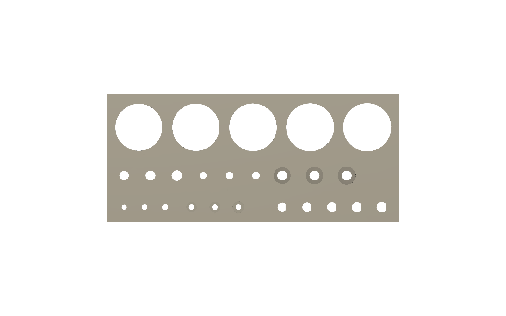
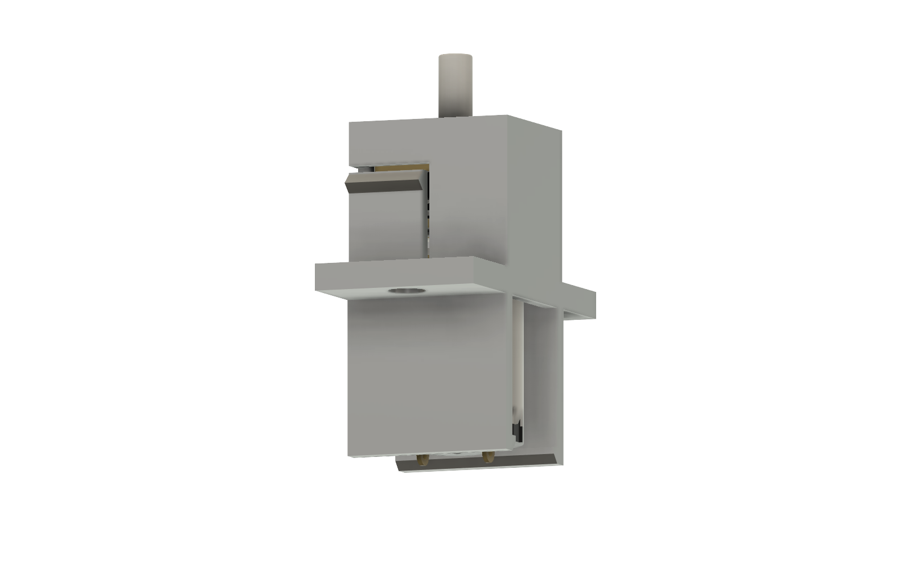

# N20 print files

Exported from the Fusion design *Cam Rotation N20* and oriented for printing (z = 0 is the bed) by [`../fusion/orient_stl.py`](../fusion/orient_stl.py). All files are binary STL in millimetres. `raw/` (not in git) holds the same parts in the model's coordinates.

<!-- parts -->
| Part | Orientation | Size on bed (mm) | Bed contact (mm²) |
|---|---|---|---|
| N20_Mount | flange (wall face) down | 109.0 × 44.8 × 48.6 | 3858 |
| N20_Cartridge | on its side (-x face down), arms flat along the bed | 29.6 × 29.0 × 15.0 | 268 |
| N20_Socket_Coupon | socket coupon: plate top down, as the mount | 20.5 × 27.0 × 12.4 | 341 |
| N20_Control_Pod | front panel down, open back up | 39.2 × 38.0 × 24.0 | 955 |
| N20_PETG_Fit_Coupon | flat side down, labels up | 100.0 × 44.0 × 6.5 | 3085 |
| N20_Mount_Fit_Coupon_Wall | mount fit coupon: wall top down, as the mount | 32.0 × 11.2 × 36.4 | 192 |
| N20_Mount_Fit_Coupon_Base | mount fit coupon: base inside face down, underside up as on the mount | 37.5 × 35.2 × 4.0 | 1020 |
| N20_Mount_Fit_Coupon_Pod | mount fit coupon: pod front panel down, as the pod | 10.0 × 19.0 × 24.0 | 171 |
| N20_Adapter_075 | D-bore end down, socket up | 25.4 × 25.4 × 24.0 | 462 |
| N20_Adapter_0625 | D-bore end down, socket up | 22.2 × 22.2 × 24.0 | 347 |
| N20_Adapter_025 | D-bore end down, socket up | 12.6 × 12.6 × 24.0 | 99 |
| N20_Adapter_Clamp_0625 | 5/8 clamp, D-bore end down | 26.5 × 24.3 × 24.0 | 347 |
| N20_Adapter_Clamp_025 | 1/4 clamp, socket end down (more bed contact) | 19.9 × 16.3 × 24.0 | 130 |
| N20_Adapter_075_Sleeved | 3/4 sleeved, D-bore end down | 26.5 × 26.5 × 24.0 | 507 |
| N20_Clamp_0625_cap | 5/8 clamp cap, split face down | 26.5 × 17.5 × 12.5 | 163 |
| N20_Clamp_025_cap | 1/4 clamp cap, split face down | 19.9 × 17.5 × 9.2 | 218 |
<!-- /parts -->

Parts the N20 drive shares with the MG90S drive aren't repeated here. Print them from [`drives/mg90s/cad/stl`](../../../mg90s/cad/stl/README.md): `Panel_Fit_Coupon`, the bushings, the dowel gauges and the shims. The N20 drive now has its own control pod (`N20_Control_Pod`, with the J3 connector holder) and its own clamp caps (flat counterbores for M3 cap heads).

**Updated 2026-10-26 (Fusion *Cam Rotation N20* version 10).** Reprint everything in this folder except the plain adapters (`N20_Adapter_075`, `_0625`, `_025`, `_075_Sleeved`), which didn't change. What's new: the motor cartridge, the 14 mm capacitor seat, the diode channel under the base, zip-tie anchors, cap-head clamps, the pod's connector holder, and the PETG fit coupon. `N20_Fit_Coupon` is retired: the cartridge itself and the PETG coupon cover what it tested.

**Added 2026-10-26 (version 11): `N20_Mount_Fit_Coupon_Wall`, `_Base` and `_Pod`,** pieces of the real mount and pod that check the capacitor, diode, board, cartridge, zip-tie and connector fits before the long prints. Nothing else changed.

**Updated 2026-10-27 (version 13): `N20_Mount` only.** The slot between the base and the N20 plate, open at both ends, is now solid, so supports can't get trapped in it (sliced on an A1 with build-plate supports: none there now, and the print drops from about 3 h to 2 h 50 min; 6.6 g more PETG). The cartridge socket and its M3 pilots still cut through it. The wall and base coupon files changed by the same fill, but their fits didn't, so coupons you've already printed still count.

**Updated 2026-10-27 (version 14): snap-fit motor and cartridge.** Reprint `N20_Cartridge` (it now prints on its side) and `N20_Mount` (latch pockets in the socket). New: `N20_Socket_Coupon`, the mount round the socket, to test the latch before the mount. No screws are needed; see [Snap-fit motor](../../README.md#snap-fit-motor-2026-10-27).

## Test prints, in order

Each step checks something before you commit to a longer print. Print these in PETG if that's what the full build will be: PETG holes come out a little different from PLA's.

### 1. `N20_PETG_Fit_Coupon` (about 15 g)

Every hole has its size engraved under it. Find the one that fits in each row and note it.

| Row | Labels | Check | Then set |
|---|---|---|---|
| 5/8" dowel | +0.2 … +0.6 (mm over 15.875) | The hole the dowel **slides and turns in** freely is the bushing clearance; the one it **pushes into snugly** is the adapter socket clearance. | `hole_clear` (0.5) and `fit_clear` (0.3) |
| M3 clearance | C3.2, C3.4, C3.6 | The smallest an M3 screw drops through. | `clamp_clear` and `cart_m3_clear` (3.4) |
| M3 pilot | P2.4, P2.5, P2.6 (6.5 mm deep) | Drive an M3 × 8 in: it should cut its thread firmly without splitting the plastic. | `clamp_pilot` and `cart_m3_pilot` (2.5) |
| M3 cap head | H5.8, H6.0, H6.2 (3.2 mm deep) | The socket cap head drops in and sits flat, flush or just below. | `clamp_cbore` (6.0) |
| M1.6 clearance | 1.7, 1.9, 2.1 (in the 3 mm strip) | The smallest an M1.6 screw drops through. | `m16_clear` (1.9) |
| M1.6 counterbore | c3.6, c3.8, c4.0 (1.5 mm deep) | Pan head on a split lock washer sits flush. | `m16_cbore` (3.8) |
| D-bore | .10 … .30 (clearance per side) | Push the motor shaft in, flat to flat: the one that goes on by hand without wobble. | `n20_bore_clear` (0.15) |

### 2. `N20_Cartridge` and `N20_Socket_Coupon` (about 21 + 15 min, 3 + 5 g)

Print both the way they load, with no supports: the cartridge lies on its side, the socket coupon on its plate face like the mount. **Before printing, measure your motor** from the gearbox face to the back of the end cap. The hooks are set for 25.1 mm (`n20_len`), so tell me if yours differs.

| Check | If it's wrong |
|---|---|
| The motor pushes up into the cartridge until its gearbox face meets the top plate, and both arms click over the end cap. It shouldn't rattle up and down. | Won't click: the motor is longer than `n20_len`. Rattles: it's shorter. Measure it and tell me. Gearbox tight in the sleeve: raise `n20_clear` (0.3 mm). |
| Spreading the two arms by hand lets the motor out, without the arms whitening or staying bent. | Tell me: the hooks or arms can be made thinner. |
| The **empty** cartridge pushes up into the socket coupon until both latches click and the flange sits flat. It pulls back out by the flange. | Too stiff or won't click: tell me how it felt; the bumps or the tongue slits can change. |
| With the motor in, the cartridge won't pull out of the socket coupon. | The latch is too shallow for your print; tell me. |

### 3. `N20_Mount_Fit_Coupon_Wall`, `_Base` and `_Pod` (about 13 g together)

Three pieces cut from the real mount and pod in Fusion (boxes intersected with them, so they follow every change to either). Together they check every fit on the long prints before you commit to them.

**Print each file the way it loads; don't use lay flat or auto-orient.** Each piece is already the same way up as the full part it comes from, which is what makes its holes and pockets come out the same size: the wall piece stands on the top of the wall (like the mount, flange down), the base piece lies on the base's inside face with its underside up (as on the mount), and the pod piece stands on its front panel (like the pod). Turning them over to get more bed contact would test the wrong thing.

| File | Supports | Time on an A1 (PETG, 0.2 mm) |
|---|---|---|
| `N20_Mount_Fit_Coupon_Wall` | none | about 32 min |
| `N20_Mount_Fit_Coupon_Base` | none | about 16 min |
| `N20_Mount_Fit_Coupon_Pod` | **tree supports, allowed on the model** (not build plate only): the connector holder starts in mid-air over the front panel | about 16 min |

| Piece | Check | If it's wrong |
|---|---|---|
| Wall piece | The capacitor snaps into its seat. The XIAO drops into its pocket, with its soldered wire ends in the 2.5 mm relief under each pin row. The PD board drops into its seat on the pad and rests on the 1 mm ledge, its bottom-side parts clear of the recess floor. Your zip ties go through the XIAO's and the PD board's slots, and round the bar in anchor A1 at the bottom of the wall. | Capacitor: `c1_seat_dia`. Boards: `board_clear` (0.3 mm), `solder_relief_d` (2.5 mm), `pd_relief_d` (3.5 mm). |
| Base piece | The motor cartridge slides through the socket (here only the 4 mm base) and its flange sits flat on the base; the M3 pilots line up with the flange holes (their depth is tested on the PETG coupon). The DRV8833 drops into its pocket with its wire ends in the relief. The diode lies in its channel with its lead in the slot to the DRV8833 pocket. A zip tie goes round the bar in anchors A1 and A2. | Cartridge: `n20_clear`, `cart_m3_pilot`. DRV8833: `board_clear`, `solder_relief_d`. |
| Pod piece | The JST-PH header slides into its holder from the open back and stops against the two small ledges. | Tell me how far off it is. |

### 4. `Panel_Fit_Coupon` and the dowel gauges (from the MG90S folder)

Skip these if you've done them for the MG90S drive. Follow steps 1 and 3 of the [MG90S print order](../../../mg90s/cad/stl/README.md#print-order-for-a-fit-test).

### 5. One adapter for your dowel

Print the adapter for the dowel you'll use (`N20_Adapter_075`, `_0625` or `_025`; the clamp version plus its cap if the dowel is sanded). Check that it slides onto the motor shaft with the flat lined up, and that the dowel pushes into the socket snugly.

### 6. `N20_Mount` and `N20_Control_Pod` (the long prints)

Only once steps 1, 2, 3 and 5 fit. The fit coupon has already checked the fits below; on the full mount, look for the things a coupon can't show: the face plate bridged cleanly, the flange is flat, and the PD pad's overhang printed cleanly. Then check the mount after printing:

- the empty cartridge clicks up into the socket in the base and its flange sits flat under the base;
- the capacitor snaps into its seat beside the XIAO pocket;
- the diode lies in the channel under the base, and its lead slot runs from the wall edge to the DRV8833 pocket;
- the zip-tie anchors are open: two slots and a tunnel under the electronics-side wall (A1) and under the base on the pod side (A2);
- the DRV8833 pocket and the 2.5 mm relief slots under its pin rows (and under the XIAO's) are clean;
- the PD board drops into its seat in the pad and rests on the 1 mm ledge round its edges.

In the pod, check that the JST-PH header slides into its holder from the open back and stops against the two small ledges.

### What to send back

Tell me which hole fitted in each row of the PETG coupon, how the cartridge snaps felt, how each part sat in the mount fit coupon, and anything that was tight or loose. I'll set the parameters in Fusion and re-export.

## Suggested settings

| Part | Material | Layer | Walls | Infill | Supports |
|---|---|---|---|---|---|
| N20_PETG_Fit_Coupon | PETG | 0.2 mm | 3 | 20% | none |
| N20_Cartridge | PETG | 0.16 mm | 3 | 40% | none: printed on its side (as the file loads), so the snap arms and latch tongues bend along their layers |
| N20_Socket_Coupon | PETG | 0.2 mm | 3 | 25% | none (same settings as the mount) |
| N20_Mount_Fit_Coupon_Wall, _Base | PETG | 0.2 mm | 3 | 25% | none (same layer, walls and infill as the mount, so its fits come out the same) |
| N20_Mount_Fit_Coupon_Pod | PETG | 0.2 mm | 3 | 20% | **tree supports, allowed on the model**, as for the pod |
| Adapters, clamps, caps | PETG | 0.12–0.16 mm | 4 | 40% | none |
| N20_Control_Pod | PETG | 0.2 mm | 3 | 20% | **tree supports, allowed on the model** (not build plate only): printed front panel down, the JST holder starts in mid-air above the front panel's inside face |
| N20_Mount | PETG | 0.2 mm | 3 | 25% | **yes**, build plate only: under the face plate (through the bushing hole) and the PD pad |

PETG notes: print a little slower and hotter than PLA, turn off ironing, and use a glue stick or textured sheet on smooth PEI (PETG can bond too well). Holes usually come out slightly smaller than in PLA, which is what the coupon is for.

Printed flange down, the mount's face plate is a 29 mm bridge between the side walls, now with the cartridge socket through it. The supports under it stand in the open space the adapter turns in and come out through the open ends; the narrower slot above the plate, under the base, is filled solid so nothing gets trapped there. If yours sags, turn on supports everywhere (not just from the build plate) for that print. The PD board's pad also leaves a 3.5 mm overhang facing the bed; build-plate supports reach it.

## Fitting the motor, the driver and the panel

The full order, with the tool for each step, is in the drive's [assembly order](../../README.md#assembly-order-and-tool-access).

- **Motor:** no screws. The empty cartridge clicks up into the socket in the base, then the motor pushes up into the cartridge, its shaft into the adapter's D-bore, until the arms click over its end cap. The M1.6 counterbores and M3 flange holes are still there if a snap ever needs backing up with screws.
- **Clamps:** two **M3 × 8** socket cap screws per clamp, heads in the flat counterbores on the cap. Turn the cap toward an open end of the mount to reach them with a 2.5 mm hex key. With the screws tight, the 5/8 clamp sweeps 14.3 mm from the axis, inside the 0.6 mm relief in both side walls (15.3 mm). Don't use M3 × 10: on the 5/8 clamp the tip would come out of the side.
- **DRV8833 module:** solder its wires first, then stick it into the pocket on the underside of the base with a square of double-sided foam tape, component side out. Leave its **J1** jumper open.
- **Diode:** lay it in its channel under the base with the banded end toward the wall, bend the cathode lead round the edge and up to the XIAO's 5V pad, and run the anode lead along its slot to the DRV8833's VCC pin. A dab of glue holds it.
- **Capacitor:** press it into its seat, legs down; the seat's 7.8 mm mouth holds the 8 mm can.
- **Control panel connector (J3):** slide the JST-PH header into its holder in the pod from the open back, pins toward the front panel, and fix it with a drop of glue. The mount harness ends in the PHR-6 housing that plugs into it.
- **Zip ties:** one through anchor A1 round the two power wires under the wall, one through A2 round the two motor wires under the base.
