# Step-by-step wiring: N20 perfboard (rev C)

One wire, link or part per step, in the [build order](perfboard.md#build-order). Each picture shows everything already done in grey and the current step in its real colour, with its end holes circled and named. The [hole map](images/perfboard.svg) and the [wire list](wiring.md#point-to-point-wire-list) show the whole board at once; this page is the same board taken one step at a time. The wire IDs, colours and cut lengths come from the [cut list](cut-list.csv).

**Reading the pictures**

- Columns **A–E** and **F–J**, rows **1–17**. Every hole in a row's half is joined to the other four in that half: a **strip**. The strips that the current step joins are drawn yellow.
- **Component side** pictures show the board as in the hole map, column A on the left.
- **Hole names are the component side's.** This board's underside letters are **mirrored**: the hole called A2 here is printed **J2** underneath (A↔J, B↔I, C↔H, D↔G, E↔F; the row numbers are the same). Wherever you work from the underside, go by the printed underside name given in brackets.
- **Underside** pictures show the board as you see it turned over, labelled with the letters printed on the underside, so they read A–J left to right just like the board in your hand. Each circled end shows its printed name large and its component-side name small.
- Checks use the component-side names: probe from the component side, or use the printed names in brackets.
- A **check** at the end of each step says what should connect and what must not. Test each one on the meter's **continuity setting**: connected means it beeps (or reads near 0 Ω). The few checks that need the diode-test or resistance setting say so.

## Before you start

- **Wire:** 30 AWG stranded, in red (+5 V), black (GND), green, blue, white and yellow. Only W14 and W15 differ: they're the motor's own leads.
- **Tin every stripped end** before it goes through a hole, so the strands don't splay.
- **Laying a link:** solder one end, press the wire flat along its lane and pinch the corners square with tweezers, hold the corners down with Kapton tape, then solder the far end. Keep it off the holes it crosses, and don't anchor wires through spare holes: every hole is part of a strip. Once the step's check passes, a dab of hot glue can hold it for good.
- **Prepare the modules** (build step 1): desolder U1's screw terminal and set its switches to 5 V. Pull the unused pins out of the header strips: the DRV8833 keeps D3–D6 and H2, H3, H6; the Super Mini keeps D12–D17 and H11–H15 (H10, GPIO5, stays out). Fit the strips to the modules with the perfboard as a jig, and solder them **to the modules only**.

## On the bench: D1 and the links

### Step 1: D1, the 1N5817 diode, standing

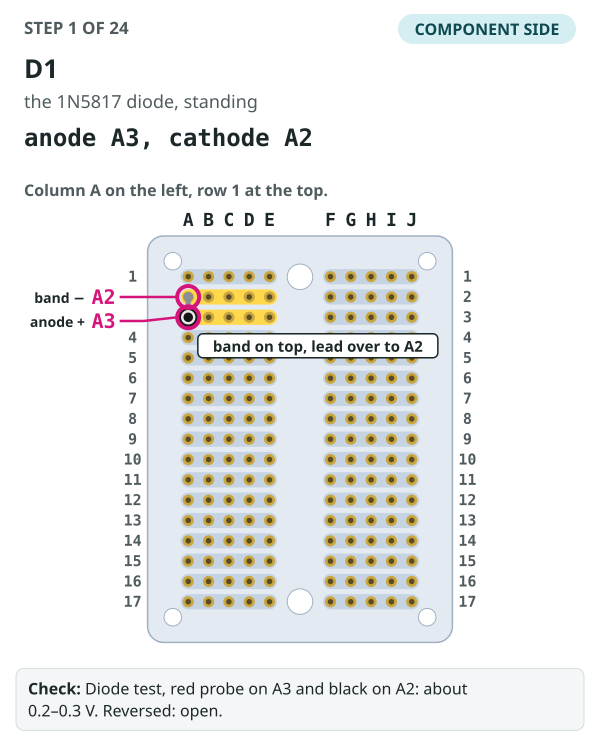

**Do this:**

1. The banded end is the cathode (−); the plain end is the anode (+). See the sketch.
2. On top: stand the anode lead in **A3** (printed J3 underneath), band at the top, and bend the top lead over and down into **A2** (printed J2 underneath).
3. Turn the board over (underside up) and solder each lead at printed **J3** (top A3), printed **J2** (top A2). Trim the leads.
4. Check, as below.

- **Part:** D1
- **Holes:** anode A3, cathode A2
- **Side:** component side
- **What it does:** D1 joins the 5 V that feeds the motor driver (strip 3 left) to the Super Mini's 5 V (strip 2 left), one way only.
- **How:** Stand it in A3 with the banded (cathode) end at the top, bend the top lead over and down into A2, and solder both from the underside.
- **Check:** Diode test, red probe on A3 and black on A2: about 0.2–0.3 V. Reversed: open.

**The ten links** go on the underside, shortest first. Turn the board over: from here to step 11 the pictures show the underside as you see it, with the mirrored letters printed there; each hole is given by both names.

### Step 2: W16, red, B7 → C3

**Do this:**

1. Turn the board over (underside up).
2. Start at hole printed **I7** (top B7): push the tinned end in and solder it.
3. Lay the wire flat along the drawn path, between the existing joints; pinch the corners and hold them with Kapton tape.
4. End at hole printed **H3** (top C3): push it in and solder it.
5. Check, as below.

- **Wire:** W16, red, 30 AWG stranded
- **Cut:** 25 mm
- **From → to:** B7 → C3 (printed I7 → H3 on the underside)
- **Side:** underside (link)
- **What it does:** Takes +5 V from the bus (row 7) to the motor driver's VCC strip and D1's anode.
- **Check:** B7 connects to A3 (D1's anode). B7 must not connect to B8 (the ground bus).

### Step 3: W18, black, B8 → C4

**Do this:**

1. Turn the board over (underside up).
2. Start at hole printed **I8** (top B8): push the tinned end in and solder it.
3. Lay the wire flat along the drawn path, between the existing joints; pinch the corners and hold them with Kapton tape.
4. End at hole printed **H4** (top C4): push it in and solder it.
5. Check, as below.

- **Wire:** W18, black, 30 AWG stranded
- **Cut:** 25 mm
- **From → to:** B8 → C4 (printed I8 → H4 on the underside)
- **Side:** underside (link)
- **What it does:** Takes ground from the bus (row 8) to the motor driver's GND strip.
- **Check:** B8 connects to A4. B8 must not connect to B7, and C4 must not connect to C3.

### Step 4: W5, green, C12 → C5

**Do this:**

1. Turn the board over (underside up).
2. Start at hole printed **H12** (top C12): push the tinned end in and solder it.
3. Lay the wire flat along the drawn path, between the existing joints; pinch the corners and hold them with Kapton tape.
4. End at hole printed **H5** (top C5): push it in and solder it.
5. Check, as below.

- **Wire:** W5, green, 30 AWG stranded
- **Cut:** 35 mm
- **From → to:** C12 → C5 (printed H12 → H5 on the underside)
- **Side:** underside (link)
- **What it does:** MOT_IN1: the Super Mini's GPIO18 to the driver's IN3, the forward PWM.
- **Check:** C12 connects to A5. It should not touch C13 or C11 next door.

### Step 5: W12, blue, C14 → C6

**Do this:**

1. Turn the board over (underside up).
2. Start at hole printed **H14** (top C14): push the tinned end in and solder it.
3. Lay the wire flat along the drawn path, between the existing joints; pinch the corners and hold them with Kapton tape.
4. End at hole printed **H6** (top C6): push it in and solder it.
5. Check, as below.

- **Wire:** W12, blue, 30 AWG stranded
- **Cut:** 35 mm
- **From → to:** C14 → C6 (printed H14 → H6 on the underside)
- **Side:** underside (link)
- **What it does:** MOT_IN2: GPIO20 to the driver's IN4, the reverse PWM.
- **Check:** C14 connects to A6. It should not touch C13, C15 or W5.

### Step 6: W4, black, C8 → C16

**Do this:**

1. Turn the board over (underside up).
2. Start at hole printed **H8** (top C8): push the tinned end in and solder it.
3. Lay the wire flat along the drawn path, between the existing joints; pinch the corners and hold them with Kapton tape.
4. End at hole printed **H16** (top C16): push it in and solder it.
5. Check, as below.

- **Wire:** W4, black, 30 AWG stranded
- **Cut:** 40 mm
- **From → to:** C8 → C16 (printed H8 → H16 on the underside)
- **Side:** underside (link)
- **What it does:** Ground from the bus to the Super Mini's GND strip.
- **Check:** C16 connects to B8. C16 must not connect to C15 (3V3) or C17 (5V).

### Step 7: W22, red, C2 → H7

**Do this:**

1. Turn the board over (underside up).
2. Start at hole printed **H2** (top C2): push the tinned end in and solder it.
3. Lay the wire flat along the drawn path, between the existing joints; pinch the corners and hold them with Kapton tape.
4. End at hole printed **C7** (top H7): push it in and solder it.
5. Check, as below.

- **Wire:** W22, red, 30 AWG stranded
- **Cut:** 50 mm
- **From → to:** C2 → H7 (printed H2 → C7 on the underside)
- **Side:** underside (link)
- **What it does:** The Super Mini's 5 V, after D1, across the channel to the strip where C3's + lead will go.
- **Check:** H7 connects to A2. H7 must not connect to H8 or H6.

### Step 8: W21, yellow, A15 → I10

**Do this:**

1. Turn the board over (underside up).
2. Start at hole printed **J15** (top A15): push the tinned end in and solder it.
3. Lay the wire flat along the drawn path, between the existing joints; pinch the corners and hold them with Kapton tape.
4. End at hole printed **B10** (top I10): push it in and solder it.
5. Check, as below.

- **Wire:** W21, yellow, 30 AWG stranded
- **Cut:** 55 mm
- **From → to:** A15 → I10 (printed J15 → B10 on the underside)
- **Side:** underside (link)
- **What it does:** The Super Mini's 3.3 V to the strip where the knob's pin 1 will go. Yellow, not red: this is 3.3 V only.
- **Check:** A15 connects to J10. I10 must not connect to I11 (the wiper strip), and A15 must not connect to A16.

### Step 9: W13, white, C13 → J6

**Do this:**

1. Turn the board over (underside up).
2. Start at hole printed **H13** (top C13): push the tinned end in and solder it.
3. Lay the wire flat along the drawn path, between the existing joints; pinch the corners and hold them with Kapton tape.
4. End at hole printed **A6** (top J6): push it in and solder it.
5. Check, as below.

- **Wire:** W13, white, 30 AWG stranded
- **Cut:** 55 mm
- **From → to:** C13 → J6 (printed H13 → A6 on the underside)
- **Side:** underside (link)
- **What it does:** DRV_SLEEP: GPIO19 to the driver's EEP pin, which wakes it.
- **Check:** C13 connects to J6. It should not touch C12, C14, or W22 where they cross.

### Step 10: W17, red, B2 → C17

**Do this:**

1. Turn the board over (underside up).
2. Start at hole printed **I2** (top B2): push the tinned end in and solder it.
3. Lay the wire flat along the drawn path, between the existing joints; pinch the corners and hold them with Kapton tape.
4. End at hole printed **H17** (top C17): push it in and solder it.
5. Check, as below.

- **Wire:** W17, red, 30 AWG stranded
- **Cut:** 60 mm
- **From → to:** B2 → C17 (printed I2 → H17 on the underside)
- **Side:** underside (link)
- **What it does:** The Super Mini's 5 V: from D1's cathode strip down the board to the 5V pin's strip.
- **Check:** C17 connects to A2 and to H7. C17 must not connect to C16 (GND).

### Step 11: W23, black, A16 → H8

**Do this:**

1. Turn the board over (underside up).
2. Start at hole printed **J16** (top A16): push the tinned end in and solder it.
3. Lay the wire flat along the drawn path, between the existing joints; pinch the corners and hold them with Kapton tape.
4. End at hole printed **C8** (top H8): push it in and solder it.
5. Check, as below.

- **Wire:** W23, black, 30 AWG stranded
- **Cut:** 65 mm
- **From → to:** A16 → H8 (printed J16 → C8 on the underside)
- **Side:** underside (link)
- **What it does:** Ground to the strip where C3's − lead will go.
- **Check:** H8 connects to B8. H8 must not connect to H7 (5 V) or H9.

## On the bench: J4, RV1 and C3

### Step 12: J4, the motor plug (JST-PH 2-pin, side entry)

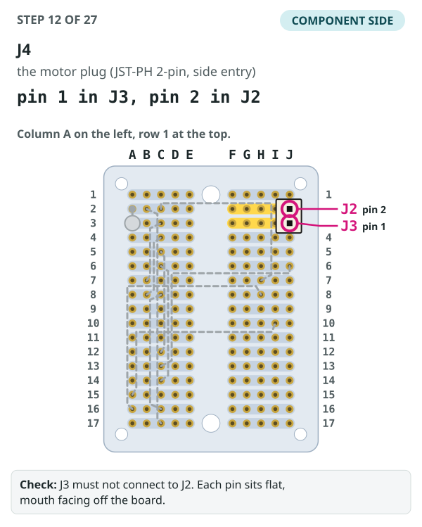

**Do this:**

1. Its mouth faces the right-hand edge, off the board. Splay the 2 mm-pitch pins a little so they reach the holes.
2. On top: pin 1 in **J3** (printed A3 underneath), pin 2 in **J2** (printed A2 underneath).
3. Turn the board over (underside up) and solder each lead at printed **A3** (top J3), printed **A2** (top J2). Trim the leads.
4. Check, as below.

- **Part:** J4
- **Holes:** pin 1 in J3, pin 2 in J2
- **Side:** component side
- **What it does:** The motor's plug: pin 1 in the OUT3 strip (row 3 right), pin 2 in the OUT4 strip (row 2 right).
- **How:** Splay the 2 mm-pitch pins a little so they reach the holes, mouth toward the right-hand edge. Push in and solder from the underside.
- **Check:** J3 must not connect to J2. Each pin sits flat, mouth facing off the board.

### Step 13: RV1, the 10 kΩ speed knob

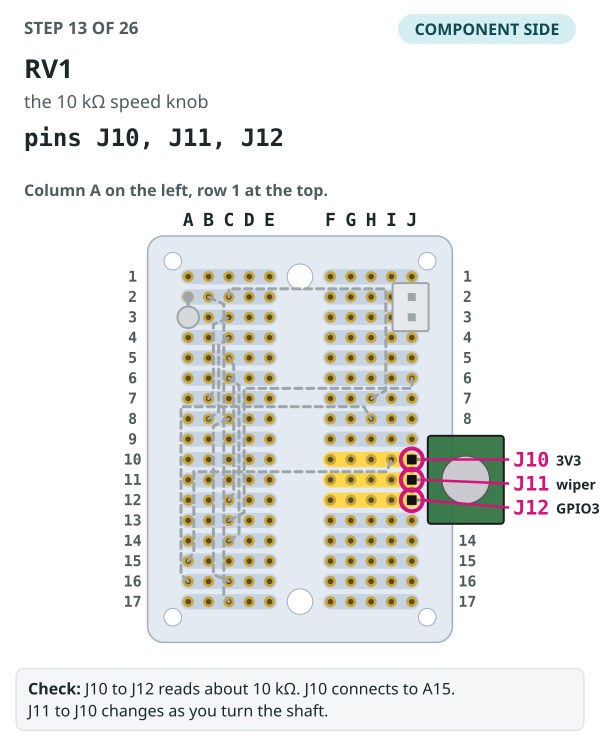

**Do this:**

1. Snip off its two mounting tabs if it has them. Shaft up, body off the right-hand edge.
2. On top: its three pins in **J10** (printed A10 underneath), **J11** (printed A11 underneath) and **J12** (printed A12 underneath).
3. Turn the board over (underside up) and solder each lead at printed **A10** (top J10), printed **A11** (top J11), printed **A12** (top J12). Trim the leads.
4. Check, as below.

- **Part:** RV1
- **Holes:** pins J10, J11, J12
- **Side:** component side
- **What it does:** The knob: pin 1 in the 3V3 strip (fed by W21), the wiper in the GPIO4 strip, pin 3 in the GPIO3 strip.
- **How:** Snip off its two mounting tabs if it has them. Shaft up, body off the right-hand edge. Solder from the underside.
- **Check:** J10 to J12 reads about 10 kΩ. J10 connects to A15. J11 to J10 changes as you turn the shaft.

### Step 14: C3, the 470 µF hold-up capacitor, lying down

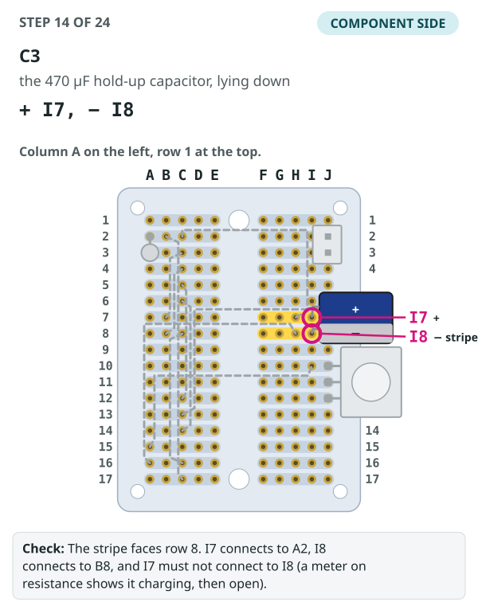

**Do this:**

1. The striped side is −; the other lead is +. See the sketch.
2. Bend both leads down 90° about 1 mm from the can. On top: + in **I7** (printed B7 underneath), − (stripe) in **I8** (printed B8 underneath); lay it flat, its end past the right-hand edge.
3. Turn the board over (underside up) and solder each lead at printed **B7** (top I7), printed **B8** (top I8). Trim the leads.
4. Check, as below.

- **Part:** C3
- **Holes:** + I7, − I8
- **Side:** component side
- **What it does:** Keeps the Super Mini running through a motor start or stall.
- **How:** Bend both leads down 90° about 1 mm from the can. **+ lead in I7, the striped (−) side toward I8.** Lay it flat, its end past the right-hand edge.
- **Check:** The stripe faces row 8. I7 connects to A2, I8 connects to B8, and I7 must not connect to I8 (a meter on resistance shows it charging, then open).

## On the bench: the modules and U1

### Step 15: U3, the DRV8833 module

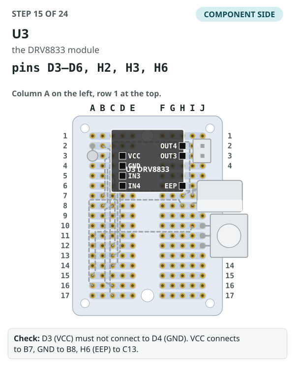

**Do this:**

1. Component side up. Check the labels on your module: VCC, GND, IN3, IN4 down one row; OUT4, OUT3, EEP on the other (see perfboard.md).
2. On top: its pins in **D3–D6** (printed G3–G6 underneath) and **H2, H3, H6** (printed C2, C3, C6 underneath).
3. Turn the board over (underside up) and solder each pin at printed **G3–G6** (top D3–D6) and **C2, C3, C6** (top H2, H3, H6).
4. Check, as below.

- **Part:** U3
- **Holes:** pins D3–D6, H2, H3, H6
- **Side:** component side
- **What it does:** The motor driver: VCC, GND, IN3 and IN4 down column D, OUT4, OUT3 and EEP in column H.
- **How:** **Check the labels on your module first** (see perfboard.md). Only these seven pins are fitted. Component side up, solder from the underside.
- **Check:** D3 (VCC) must not connect to D4 (GND). VCC connects to B7, GND to B8, H6 (EEP) to C13.

### Step 16: U2, the ESP32-C6 Super Mini

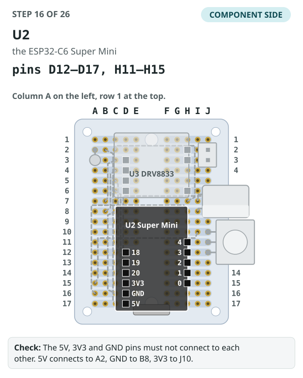

**Do this:**

1. Component side up, USB-C past row 17.
2. On top: its pins in **D12–D17** (printed G12–G17 underneath) and **H11–H15** (printed C11–C15 underneath). H10 stays empty.
3. Turn the board over (underside up) and solder each pin at printed **G12–G17** (top D12–D17) and **C11–C15** (top H11–H15).
4. Check, as below.

- **Part:** U2
- **Holes:** pins D12–D17, H11–H15
- **Side:** component side
- **What it does:** The controller: GPIO18–20, 3V3, GND and 5V down column D; GPIO4 to GPIO0 in column H. H10 (GPIO5) stays out.
- **How:** Component side up, USB-C past row 17. Solder from the underside.
- **Check:** The 5V, 3V3 and GND pins must not connect to each other. 5V connects to A2, GND to B8, 3V3 to J10.

### Step 17: U1, the PD trigger board, on foam pads

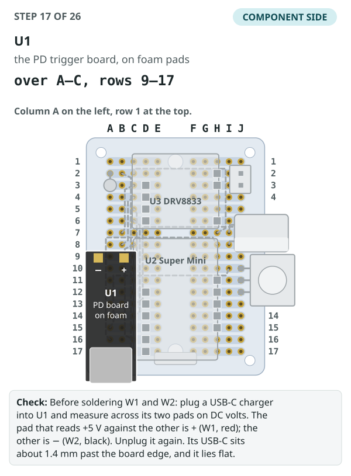

**Do this:**

1. Its screw terminal is off and its switches are set to 5 V (Before you start).
2. On top: stick it down on its two foam pads over columns A–C, rows 9–17, USB-C past row 17 beside the Super Mini's, output pads toward row 8. Nothing goes into holes.
3. Find + and − by the marking printed on your PD board, then measure them with a charger plugged in (the check).
4. Check, as below.

- **Part:** U1
- **Holes:** over A–C, rows 9–17
- **Side:** component side
- **What it does:** The USB-C power input. It isn't soldered into holes: it sits on two 3 mm foam pads over the Super Mini's left-hand strips.
- **How:** Screw terminal desoldered and switches set to 5 V (Before you start). Stick it down with its USB-C past row 17, beside the Super Mini's, and its two output pads toward row 8. **Find + and − by the marking printed on your own PD board** (+ / − or VBUS / GND), not by this picture: boards differ. On ours, − (GND) is the outer pad, toward the column A edge, and + (VBUS) the inner one, toward the channel, as drawn.
- **Check:** Before soldering W1 and W2: plug a USB-C charger into U1 and measure across its two pads on DC volts. The pad that reads +5 V against the other is + (W1, red); the other is − (W2, black). Unplug it again. Its USB-C sits about 1.4 mm past the board edge, and it lies flat.

### Step 18: W1, red, U1 + → A7

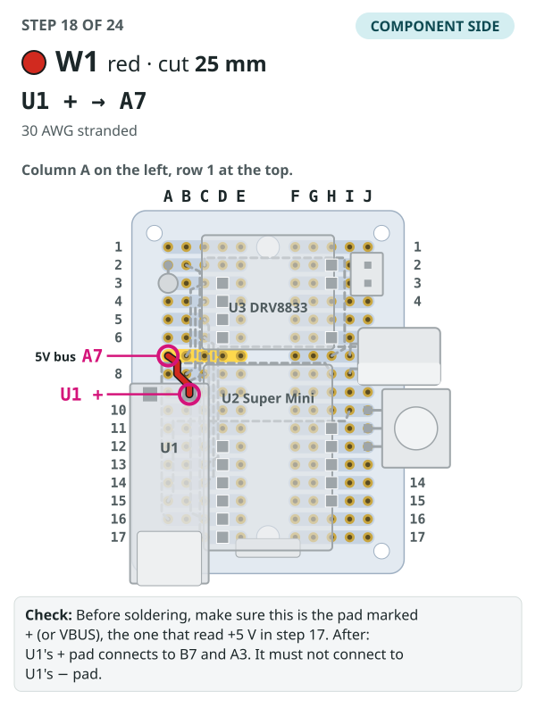

**Do this:**

1. Component side up; this one stays on top.
2. Start at U1's + (VBUS) pad, found by the marking on your board: solder the end to it.
3. Run the wire between A8 and B8, clear of W2.
4. End at hole **A7**: push it in and solder it on top.
5. Check, as below.

- **Wire:** W1, red, 30 AWG stranded
- **Cut:** 25 mm
- **From → to:** U1 + → A7
- **Side:** component side
- **What it does:** U1's 5 V output, from its + (VBUS) pad, down to the +5V bus (row 7 left). On our board + is the inner pad; go by the marking on yours. Run it between A8 and B8, so it doesn't cross W2.
- **Check:** Before soldering, make sure this is the pad marked + (or VBUS), the one that read +5 V in step 17. After: U1's + pad connects to B7 and A3. It must not connect to U1's − pad.

### Step 19: W2, black, U1 − → A8

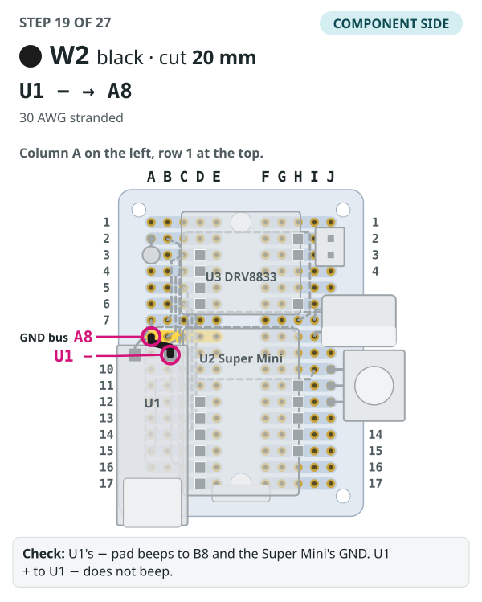

**Do this:**

1. Component side up; this one stays on top.
2. Start at U1's − (GND) pad, found by the marking on your board: solder the end to it.
3. Run the wire straight to A8.
4. End at hole **A8**: push it in and solder it on top.
5. Check, as below.

- **Wire:** W2, black, 30 AWG stranded
- **Cut:** 20 mm
- **From → to:** U1 − → A8
- **Side:** component side
- **What it does:** U1's ground, from its − (GND) pad, down to the GND bus (row 8 left). On our board − is the outer pad; go by the marking on yours.
- **Check:** Before soldering, make sure this is the pad marked − (or GND). After: U1's − pad connects to B8 and the Super Mini's GND. U1 + must not connect to U1 −.

## On the drive: the button wires (W11, W6), then C1

With the board on the drive and the button in its pod mount. The button's two wires (W11, W6) run straight from it, through the base tunnel and behind the board: push each **up from the underside** and solder it on the component side. There's no direction switch and no panel connector, so the pod stays wired to the board. Both go in before C1: it stands over A4, the hole W11 uses.

![The perfboard on the drive, seen edge-on. The mount is at the bottom; its -Y face holds the board on supports, with a gap between them. The board's underside faces the mount and its component side faces out, where you solder. The button's two wires come from the pod through the base tunnel, run up the mount's face in the gap behind the board, and each comes up through its own hole to be soldered on top. C1 stands on the board and its top comes through the cover. Nothing wraps round the board's edge.](images/steps-wiring/on-the-drive.svg)

### Step 20: W11, black, button lead B → A4

![Step 20: The perfboard seen from the component side, column A on the left, with the 19 earlier steps drawn in grey. Hole A4 (printed J4 on the underside) is marked with a dot in a ring where W11, black, comes up from below; a dashed line shows it running behind the board to the left edge, on to the button (lead B). Below, a side view shows the board edge-on over the mount: the wire runs along the gap behind the board, up through the hole, and is soldered on the component side with its stub trimmed.](images/steps-wiring/step-20-W11.svg)

**Do this:**

1. Start at the button (lead B): the button's own lead, or 30 AWG spliced to it in the pod (see [the button](wiring.md#the-button-s1)).
2. Run the wire behind the board, between the board and the mount.
3. Push the other end up through the hole printed **J4** on the underside (top A4).
4. Turn to the top and solder it at **A4**. Trim the stub.
5. Check, as below.

- **Wire:** W11, black, 30 AWG stranded (or the button's own lead)
- **Cut:** 170 mm
- **From → to:** button lead B → A4 (push it in at printed J4 on the underside)
- **Side:** in from the underside, soldered on the component side
- **What it does:** The button's ground side, straight from the button to GND (strip 4 left). Solder it before C1: C1 stands over A4.
- **Check:** The button's lead B connects to B8. It must not connect to I14. Keep the joint at A4 low and neat: C1 stands just above it.

### Step 21: W6, white, button lead A → I14

![Step 21: The perfboard seen from the component side, column A on the left, with the 20 earlier steps drawn in grey. Hole I14 (printed B14 on the underside) is marked with a dot in a ring where W6, white, comes up from below; a dashed line shows it running behind the board to the right edge, on to the button (lead A). Below, a side view shows the board edge-on over the mount: the wire runs along the gap behind the board, up through the hole, and is soldered on the component side with its stub trimmed.](images/steps-wiring/step-21-W6.svg)

**Do this:**

1. Start at the button (lead A): the button's own lead, or 30 AWG spliced to it in the pod (see [the button](wiring.md#the-button-s1)).
2. Run the wire behind the board, between the board and the mount.
3. Push the other end up through the hole printed **B14** on the underside (top I14).
4. Turn to the top and solder it at **I14**. Trim the stub.
5. Check, as below.

- **Wire:** W6, white, 30 AWG stranded (or the button's own lead)
- **Cut:** 200 mm
- **From → to:** button lead A → I14 (push it in at printed B14 on the underside)
- **Side:** in from the underside, soldered on the component side
- **What it does:** BTN: the button's other lead, straight to GPIO1 (strip 14 right). Pressing the button joins GPIO1 to ground.
- **Check:** The button's lead A connects to H14 (GPIO1), and to B8 only while you hold the button down. I14 must not connect to I13 or I15.

### Step 22: C1, the 470 µF bulk capacitor, standing

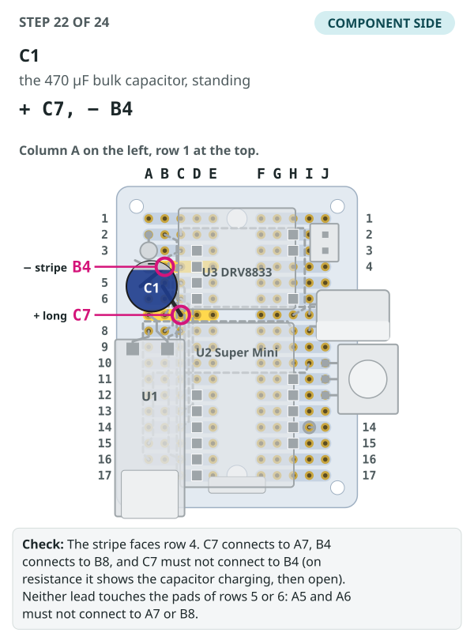

**Do this:**

1. The striped side is −; the long leg is +. See the sketch. Slip heat-shrink over both legs.
2. On top: stand it 1.5 mm up over A4–C6, stripe toward row 4; bend the + leg out to **C7** (printed H7 underneath) and the − leg to **B4** (printed I4 underneath).
3. Turn the board over (underside up) and solder each lead at printed **H7** (top C7), printed **I4** (top B4). Trim the leads.
4. Check, as below.

- **Part:** C1
- **Holes:** + C7, − B4
- **Side:** component side
- **What it does:** Steadies the 5 V bus when the motor starts. It stands over columns A–C, rows 4–7, between D1 and W1/W2, and its top comes through the cover's 9 mm hole.
- **How:** **+ is the long leg, − is the striped side** (see the sketch). Slip heat-shrink over both leads: they cross the pads of rows 5 and 6 (IN3, IN4) on the way out. Stand the can 1.5 mm off the board over A4–C6, stripe toward row 4, bend the + lead out to C7 and the − lead to B4, and solder them from the underside.
- **Check:** The stripe faces row 4. C7 connects to A7, B4 connects to B8, and C7 must not connect to B4 (on resistance it shows the capacitor charging, then open). Neither lead touches the pads of rows 5 or 6: A5 and A6 must not connect to A7 or B8.

## The motor leads

W14 and W15 are the N20's own factory leads, red and black, left soldered to its tabs (assumed about 26 AWG, unconfirmed). Solder C2 across the tabs first if it isn't on yet. Measure each lead from the motor's end cap, cut it, strip 2 mm and crimp a JST-PH contact on, then push the contact into the PHR-2 housing of the motor plug (J4). Routing and the wire clamp are in [wiring.md](wiring.md#j4-and-the-motor-wire-clamp). Red and black here don't mean +5 V and GND: this pair only runs from the motor to the motor plug (J4).

### Step 23: W14, red, motor tab → motor plug pin 1

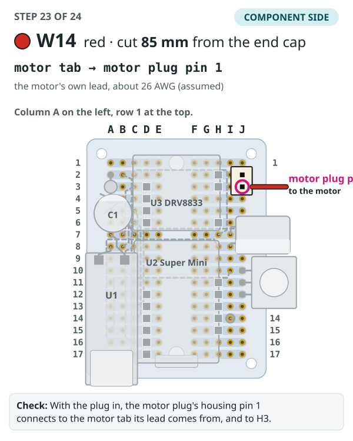

**Do this:**

1. Measure the motor's red lead 85 mm from the end cap, cut it there and strip 2 mm.
2. Crimp a JST-PH contact on.
3. Push the contact into pin 1 of the motor plug's PHR-2 housing until it clicks.
4. Leave the housing unplugged until W15 is in it too.
5. Check, as below.

- **Wire:** W14, red, the motor's own lead
- **Cut:** 85 mm, measured from the motor's end cap
- **From → to:** motor tab → motor plug pin 1
- **Side:** off the board: crimped into the motor plug's (J4's) housing
- **What it does:** The motor's own red lead, to the driver's OUT3 through pin 1 of the motor plug (J4).
- **Check:** With the plug in, the motor plug's housing pin 1 connects to the motor tab its lead comes from, and to H3.

### Step 24: W15, black, motor tab → motor plug pin 2

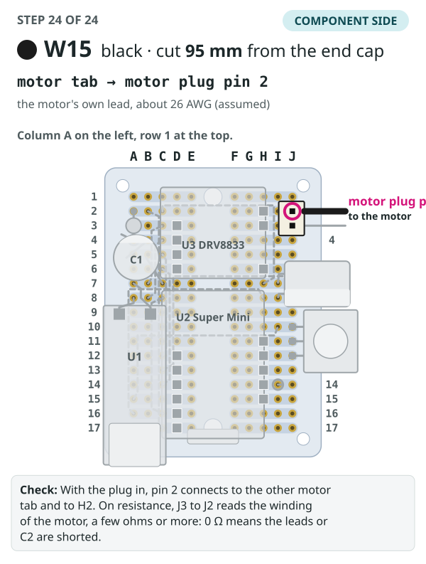

**Do this:**

1. Measure the motor's black lead 95 mm from the end cap, cut it there and strip 2 mm.
2. Crimp a JST-PH contact on.
3. Push the contact into pin 2 of the motor plug's PHR-2 housing until it clicks.
4. Plug the housing into the motor plug (J4) on the board.
5. Check, as below.

- **Wire:** W15, black, the motor's own lead
- **Cut:** 95 mm, measured from the motor's end cap
- **From → to:** motor tab → motor plug pin 2
- **Side:** off the board: crimped into the motor plug's (J4's) housing
- **What it does:** The motor's own black lead, to the driver's OUT4 through pin 2 of the motor plug (J4).
- **Check:** With the plug in, pin 2 connects to the other motor tab and to H2. On resistance, J3 to J2 reads the winding of the motor, a few ohms or more: 0 Ω means the leads or C2 are shorted.

## Last checks

1. Go through the [terminal check](wiring.md#terminal-check): every terminal should hold exactly the wires it lists.
2. **+5V, +3V3 and GND must not connect to each other**, or to the strip next door. Check B7 to B8, A15 to A16, and C17 to C16.
3. Then follow [bring-up](wiring.md#bring-up) before the first power-on.

The button's wires are covered in [wiring.md](wiring.md#the-button-s1): use its own leads if they reach, or splice in the pod. The pod no longer unplugs from the drive.

_Generated by [make_steps.mjs](images/steps-wiring/make_steps.mjs) from the same hole map as [perfboard.svg](images/perfboard.svg); the wire IDs, colours and cut lengths are checked against [cut-list.csv](cut-list.csv) when it runs._
