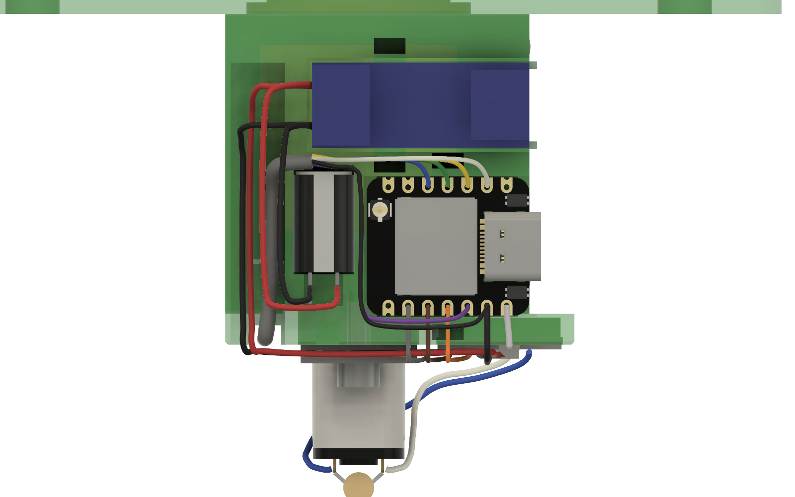

# Wiring: N20 drive

A USB-C PD trigger board set to 5 V powers a DRV8833 motor driver, which runs the N20 gearmotor, and feeds the XIAO ESP32-C6 through a diode. The XIAO drives the DRV8833's channel B inputs from D10 and D9 and holds it asleep from D8 until the firmware is running. The control pod (button, speed knob, direction switch) plugs in through a 6-pin JST-PH connector, so it can be taken off. All grounds are tied together.

## Schematic

[Open the schematic full size](images/schematic.svg) (SVG, rev B).

## Connections

| From | To | Net |
|---|---|---|
| U1 OUT+ | U3 VCC, C1 + | +5V |
| U3 VCC | D1 anode (D1's own lead) | +5V |
| D1 cathode (its own lead) | U2 5V pin | +5V, XIAO side |
| U1 OUT− | U3 GND, C1 − | GND |
| U3 GND | U2 GND | GND |
| U2 D10 (GPIO18) | U3 IN3 | MOT_IN1 (forward) |
| U2 D9 (GPIO20) | U3 IN4 | MOT_IN2 (reverse) |
| U2 D8 (GPIO19) | U3 EEP (nSLEEP) | DRV_SLEEP |
| U3 OUT3, OUT4 | M1 terminals, C2 across them | motor |
| U2 D1–D4, 3V3, GND | J3 → the control pod | BTN, SPEED, DIR_FWD, DIR_REV, +3V3, GND |

## Parts

| Ref | Part | Note |
|---|---|---|
| U1 | USB-C PD trigger board | Set to 5 V. Sits on a 3.5 mm pad on the outside of the electronics-side wall. |
| U2 | Seeed XIAO ESP32-C6 | In the mount's side pocket, USB-C toward the open end. The plug has a clear path in when the unit is assembled. |
| U3 | DRV8833 module, 12-pin, 18.5 × 16 mm | In the pocket under the base, component side out. Leave the **J1** jumper open. Channel B (IN3/IN4 → OUT3/OUT4) is used. |
| M1 | N20 gearmotor, 6 V, 100:1 | Screwed into the printed cartridge, which screws under the base; terminals point away from the base |
| C2 | Ceramic capacitor, 0.1 µF (104) | Soldered straight across the motor terminals |
| D1 | Schottky diode, 1 A, axial (1N5817) | In the channel under the base, below the XIAO's 5V pad. Its own leads make both connections. |
| C1 | Electrolytic, 470 µF, ≥ 10 V, **8 × 13 mm** | Press-fits into the 14 mm-tall seat beside the XIAO, legs down |
| J3 | JST-PH 2.0 mm, 6 pins: B6B-PH-K-S header + PHR-6 housing | Header held in the pod; the mount harness ends in the housing |
| S1, RV1, SW1 | Button, speed knob, direction switch | As on the MG90S drive, wired to J3 |

The MG90S drive's R1 is not used.

## The DRV8833 module's pins

The module has two rows of six pins. Seen from the back, where the labels are printed:

| Row toward the XIAO side | Row toward the pod side |
|---|---|
| **IN4** · **IN3** · **GND** · **VCC** · IN2 · IN1 | **EEP** · OUT1 · OUT2 · **OUT3** · **OUT4** · ULT |

Fit the module with the IN row toward the wall that carries the XIAO. Bold pins are used. Channel B is used because its pins line up with the XIAO's bottom row: IN4, IN3, GND and VCC sit directly under D9, D10, GND and 5V, so those wires drop straight down. Solder the wires from the component side; the pocket has a 2.5 mm relief under each pin row for the wire ends.

## J3: the control panel connector

The pod holds a 6-pin JST-PH header (B6B-PH-K-S) in a printed holder against its left wall, open toward the back. The mount-side harness ends in a PHR-6 housing that plugs into it from behind. To take the panel off, undo the four pod screws, pull the pod back about 15 mm and unplug J3.

| J3 pin | Signal | Mount side (to the XIAO) | Pod side |
|---|---|---|---|
| 1 | DIR_REV | W10 from D4 | W10p to SW1 lug B |
| 2 | GND | W11 from GND | W11p to SW1 centre lug |
| 3 | DIR_FWD | W9 from D3 | W9p to SW1 lug A |
| 4 | SPEED | W7 from D2 | W7p to RV1 wiper (pin 2) |
| 5 | +3V3 | W8 from 3V3 | W8p to RV1 pin 3 |
| 6 | BTN | W6 from D1 | button S1 lead A, trimmed |

Pin 1 is the end nearest the pod's floor. Crimp the mount-side wires into the PHR-6 housing (or use a pre-crimped PH pigtail and solder it to the harness), and solder the pod-side wires to the header tails.

## Point-to-point wire list

Follow this table one wire at a time and tick each off. The colours match the 3D model. The XIAO's power pin is printed 5V; it's the board's VIN.

| Wire | Colour | From | To | Notes |
|---|---|---|---|---|
| **Power harness, 22–26 AWG** | | | | |
| W1 | red | U1 + terminal | U3 VCC | Down the groove in the electronics-side wall, then along under that wall (outer lane) and in to the module. |
| W2 | black | U1 GND terminal | U3 GND | Beside W1 in the inner lane. Zip-tie W1 and W2 at anchor A1 under the wall. |
| L1 | red | C1 + (long leg) | U1 + terminal | |
| L2 | black | C1 − (stripe side) | U1 GND terminal | Reversed polarity damages the capacitor. |
| W4 | black | XIAO GND | U3 GND | Straight down the wall face and under to the module. |
| D1 | (its leads) | U3 VCC | XIAO 5V | Lay D1 in its channel, banded end toward the wall. Bend the cathode lead up the wall face to the 5V pad and the anode lead along the slot to the VCC pin. Sleeve both leads. |
| **Motor driver signals, 30 AWG** | | | | |
| W5 | orange | XIAO D10 | U3 IN3 | Straight down and under. |
| W12 | brown | XIAO D9 | U3 IN4 | Beside W5. |
| W13 | gray | XIAO D8 | U3 EEP | Down, then along under the base beside the cartridge flange to the far pin row. |
| **Motor, 22–26 AWG** | | | | |
| W14 | white | U3 OUT3 | M1 terminal (either) | If the motor runs backwards, swap W14 and W15 at the motor. Zip-tie both at anchor A2. |
| W15 | blue | U3 OUT4 | M1 other terminal | Round the far side of the motor, clear of the cartridge screw. |
| C2 | — | M1 terminal | M1 other terminal | Solder its legs to the terminals with the wires. |
| **Control harness, mount side, 30 AWG: XIAO → groove → base channel → tunnel → J3 housing** | | | | |
| W6 | white | XIAO D1 | J3 pin 6 | |
| W7 | yellow | XIAO D2 | J3 pin 4 | |
| W8 | violet | XIAO 3V3 | J3 pin 5 | 3.3 V only, never 5 V. |
| W9 | green | XIAO D3 | J3 pin 3 | |
| W10 | blue | XIAO D4 | J3 pin 1 | |
| W11 | black | XIAO GND | J3 pin 2 | |
| **Pod side, 30 AWG** | | | | |
| W10p | blue | J3 pin 1 | SW1 lug B (reverse) | |
| W11p | black | J3 pin 2 | SW1 centre lug | Ground for the whole pod. |
| W9p | green | J3 pin 3 | SW1 lug A (forward) | |
| W7p | yellow | J3 pin 4 | RV1 pin 2 (wiper) | |
| W8p | violet | J3 pin 5 | RV1 pin 3 | |
| W6p | button lead | J3 pin 6 | S1 lead A | The button's own pre-wired lead, trimmed. |
| J1 | button lead | S1 lead B | SW1 centre lug | The button's other lead, trimmed. Button leads are interchangeable. |
| J2 | black | SW1 centre lug | RV1 pin 1 | Carries ground on to the knob. |

The MG90S-era wires L3 and W3 are gone: D1's own leads do their job.

### Terminal check

When you're done, every terminal should hold exactly this many wires.

| Terminal | Wires landing here | Count |
|---|---|---|
| U1 + terminal | W1 · L1 | 2 |
| U1 GND terminal | W2 · L2 | 2 |
| U3 VCC | W1 · D1 anode lead | 2 |
| U3 GND | W2 · W4 | 2 |
| U3 IN3 / IN4 / EEP | W5 / W12 / W13 | 1 each |
| U3 OUT3 / OUT4 | W14 / W15 | 1 each |
| XIAO 5V (VIN) | D1 cathode lead | 1 |
| XIAO GND | W4 · W11 | 2 |
| XIAO D10 / D9 / D8 | W5 / W12 / W13 | 1 each |
| XIAO 3V3, D1–D4 | W8, W6, W7, W9, W10 | 1 each |
| J3 pins 1–6 | one mount-side and one pod-side wire each | 1 + 1 |
| SW1 A / centre / B | W9p / W11p + J1 + J2 / W10p | 1 / 3 / 1 |
| RV1 pins 1 / 2 / 3 | J2 / W7p / W8p | 1 each |
| M1 terminals | W14 + C2 leg / W15 + C2 leg | 2 each |

## Cut list

Lengths measured along the routes in the 3D model, plus 15% slack and 5 mm per end for stripping, rounded up to 5 mm. The mount-side control wires include the 100 mm trunk from the XIAO to J3. Also in [`cut-list.csv`](cut-list.csv).

| Wire | Colour | Gauge | Routed | **Cut** |
|---|---|---|---|---|
| W1 | red | 22–26 AWG | 87 mm | **110** |
| W2 | black | 22–26 AWG | 81 mm | **105** |
| L1 | red | 22–26 AWG | 50 mm | **70** |
| L2 | black | 22–26 AWG | 36 mm | **55** |
| W4 | black | 22–26 AWG | 20 mm | **35** |
| W5 | orange | 30 AWG | 21 mm | **35** |
| W12 | brown | 30 AWG | 21 mm | **35** |
| W13 | gray | 30 AWG | 39 mm | **55** |
| W14 | white | 22–26 AWG | 30 mm | **45** |
| W15 | blue | 22–26 AWG | 43 mm | **60** |
| W6 | white | 30 AWG | 126 mm | **160** |
| W7 | yellow | 30 AWG | 123 mm | **155** |
| W8 | violet | 30 AWG | 141 mm | **175** |
| W9 | green | 30 AWG | 120 mm | **150** |
| W10 | blue | 30 AWG | 118 mm | **150** |
| W11 | black | 30 AWG | 145 mm | **180** |
| W6p | button lead | pre-wired | 30 mm | **trim to 45** |
| W7p | yellow | 30 AWG | 26 mm | **40** |
| W8p | violet | 30 AWG | 31 mm | **50** |
| W9p | green | 30 AWG | 29 mm | **45** |
| W10p | blue | 30 AWG | 30 mm | **45** |
| W11p | black | 30 AWG | 29 mm | **45** |
| J1 | button lead | pre-wired | 22 mm | **trim to 40** |
| J2 | black | 30 AWG | 18 mm | **35** |

## Why it's wired this way

- The DRV8833 takes its motor supply straight from the PD board, so motor current doesn't pass through the XIAO. Its VCC pin is the chip's VM; the module makes its own logic supply.
- The XIAO's 3.3 V outputs drive the DRV8833 inputs directly: they accept logic levels from about 2 V up.
- EEP is the chip's sleep input. Held low by D8 until the firmware has started, the motor can't twitch at power-up. The module's J1 jumper would tie EEP high permanently, which is why it stays open.
- C2 across the motor terminals absorbs the brush noise, which otherwise couples into the knob reading and the Wi-Fi.
- D1, C1 and the single common ground do the same jobs as on the MG90S drive: see [why it's wired this way](../../mg90s/docs/wiring.md#why-its-wired-this-way) there.
- D10 (GPIO18), D9 (GPIO20) and D8 (GPIO19) are not boot-strapping pins on the ESP32-C6, so they're safe for the driver. They also sit on the XIAO's bottom row, right above the module's channel B pins, which keeps the signal wires short.
- D1's own leads carry the XIAO's 5 V: anode to the DRV8833's VCC pin (the motor supply node), cathode to the XIAO's 5V pad. There's no splice to come loose, and the diode lies where a soldering iron can reach it.
- J3 carries only the six low-current panel signals, so a small 2.0 mm JST-PH is enough.

## Bring-up

1. Set the PD board to 5 V and measure OUT+ to OUT− with a meter before wiring anything.
2. Before applying power, check each row of the terminal check table for continuity, and confirm that + and GND are not connected to each other.
3. Flash the N20 build of the firmware (see [Drive type](../../../firmware/README.md#drive-type)). The MG90S build would leave EEP low and the motor would never run.
4. Plug in J3. Turn the knob up slowly with the switch on forward. If the motor turns the wrong way, swap W14 and W15 at the motor.
5. Check the controls: the button should start and pause a story, the knob should change speed, and the switch should run forward, stop in the centre, and reverse.
